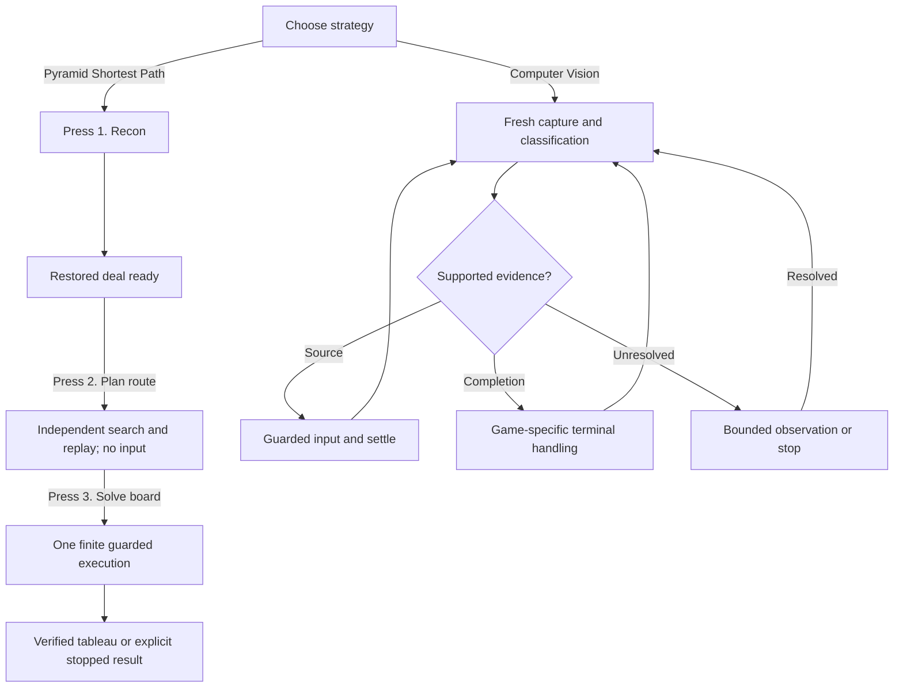

# qmp-qemu-socket

## Current 2.9.174 delivery

2.9.174 corrects native Boards challenge-header recognition using the union of
the five existing validated Boards literal ink supports, restricted to independently
proven complete word spans. All reference geometries and lengths are checked before
indexing. RGB tolerance 9, blue floor 6, word distance, letter cores, banner anchors,
boundaries and counter parsing remain unchanged. No new reference bank or dilation
is introduced. Score/Card recognition and input authority are unchanged.

The six controller gates passed, including 1687 tests with zero failures,
ignored or filtered tests. Qualification sealed 942 inputs; after qualification only
the application's manifest/lock version pair changed from 2.9.173 to 2.9.174,
leaving 940 inputs identical. Aligned locked check, release and protected help passed.
The 56 unchanged xSAR inputs retain cached sixteen-gate qualification (303 full
tests, 14 default tests and two Miri tests); xSAR remains modified/unreleased 0.9.1.
User profiles and CPU/hardening configuration are preserved. Evidence: `/home/charlie/repo/RUST/qmp-qemu-socket/Evidence/Pyramid/Validation/pyramid-challenge-174-proposal-9yca399e`.

[Verification](docs/Verification-2.9.174.md).

## Retained 2.9.173 delivery

2.9.173 places exact INITIAL source identity readiness inside the existing
six-check computed-route precondition budget. The immediately retained boundary
frame is checked first. A supported identity nonmatch remains pending; subsequent
checks use fresh captures and the existing re-observation delay (50 ms for ordinary
actions; final-action pacing retains its existing owner). Both expected MATCH
sources must match in the SAME frame. At most six checks are made before refusal.
A ready boundary adds no capture. Input remains withheld until a source proof and
its exact replayed after-state bind the prepared once-only action.

Structural frame/reader errors, unsupported source scenes and STOP still refuse
input. The two successive fresh POST source-disappearance checks remain unchanged;
a different card or undetermined rank/suit can qualify only for the already-issued
action. No input replay, RGB coverage veto or pixel-quietness test is introduced.
The next action independently identifies its own expected sources. Completion,
RECON inventory/restoration and REDEAL keep their separate semantic authority.

Failure packets and the window now carry an optional typed current-stage snapshot,
independent of the retained frame phase. It records INITIAL checks and fresh
captures, expected/observed sources, current action attempts/acknowledgements,
completed actions and separate earlier observations. Current POST confirmations
are distinct from the previous action's retained confirmations. Matching
persistence-only updates preserve the displayed stage. Unsupported fresh frames
are counted as received; a failed transport attempt is not called a retained image.
RECON reports its available acquisition/restoration counters; owners without a
detailed snapshot explicitly report that it is unavailable.

Dependencies, user Cargo profiles, CPU/hardening configuration and modified,
unreleased xSAR 0.9.1 remain unchanged. No guest operation, new live capture,
installation, staging, commit or push was performed. Fresh Coral and standard
live acceptance remains pending.

All six controller gates pass, including 1683 include-ignored tests with zero failures/ignored/filtered (149.37 seconds). Aligned locked check, native release and protected --help pass. Library qualification is PASSED (Cached): 56 unchanged inputs, 303 full tests, 14 default tests and two focused Miri checks.

[Verification](docs/Verification-2.9.173.md).

## Retained 2.9.172 delivery

2.9.172 verifies the expected original card at its exact source location before
sending the logical action once. Two successive fresh supported observations must
then stop identifying that same source card. A different recognised card or an
undetermined rank/suit (`None`) qualifies; structural reader/layout errors do not.
An original card reappearing or an unsupported observation resets the pair.

RGB coverage, replacement/ancestor identity matching and pixel quietness no longer
veto MOVE/MATCH/KING action acceptance. The next action independently identifies
its own expected source on the retained frame before input. The existing capture
budgets, probes, STOP and no-replay rules remain. RECON uses two supported source
identity checks within its existing observation loop, while ordered identities,
unique inventory, exhaustion, Undo All, confirmation and restored-board publication
remain separate requirements. Final-clear, terminal and next-board claims retain
their semantic checks on the same captured frames; source disappearance alone is
not reported as an observed board clear.

REDEAL retains its separate appearance policy. PARAMS labels its RGB controls for
that scope. Glyph recognition, package dependencies, user Cargo profiles, host CPU
and hardening configuration are preserved. xSAR remains the unchanged modified,
unreleased 0.9.1 path dependency. No guest operation, new capture, installation,
staging, commit or push was performed. Fresh guest acceptance remains pending.

All six controller gates pass, including 1678 include-ignored tests with zero failures/ignored/filtered (154.10 seconds). Aligned locked check, native release and protected --help pass. Library qualification is PASSED (Cached): 56 unchanged inputs, 303 full tests, 14 default tests and two focused Miri checks.

[Verification](docs/Verification-2.9.172.md).

## Retained 2.9.171 delivery

2.9.171 changes the default Pyramid RGB tolerance from 13 to 5 intensity
levels (5/255, about 1.96 percent). A pixel counts only when all three
same-coordinate absolute RGB differences are strictly greater than 5; alpha
is ignored. A difference of 5 is excluded and 6 qualifies. Joint coverage stays
strictly greater than 5.0 percent in the card-relative (3,4), 66-by-89 effect
quarter: 293 of 5,874 eligible pixels refuse and 294 pass. Existing guided cursor
exclusions retain their adjusted eligible denominator.

Live PARAMS still publishes a complete pair frozen per action or paired-D batch;
edits affect the next boundary. Glyph recognition and independent quiet settling
remain 31 by 49. The quiet byte tolerance 12, per-channel 1-percent/mean-2 limits,
two-capture requirement, exact identities, stock order, inventory, restoration,
terminal, STOP and no-replay checks are unchanged. No input, capture or timing
policy changed. User optimisation profiles and CPU/hardening flags are preserved.

The reported 170 Coral 4-spades/4-diamonds refusal was 289/5,874 (4.92 percent)
at tolerance 13. A later different-theme diamond report was 140/5,874 (2.38 percent),
also at 13. Immediate pre-batch pixels are missing for both reports; their actual
tolerance-5 counts and complete Recon/restoration outcomes cannot be reconstructed.
The earlier independent Coral settling stop is not established resolved.

All seven retained picture-card controls pass the tightened default, while their
exact historical counts remain tested explicitly at 13/5. These are aligned
artwork comparisons, not natural temporal transitions. Suitable retained evidence
for four other Coral picture-card suit pairs is still unavailable. Fresh complete
standard/Coral guest Recon, restoration and broader theme acceptance remain pending.

All six controller gates pass, including **1,675 include-ignored tests**, zero failed, ignored or filtered; test time 149.57 seconds. Aligned locked check, release and protected --help pass. xSAR remains the unchanged modified/unreleased 0.9.1 path dependency; its sixteen-gate receipt (303 full tests, 14 default tests, feature checks and two focused Miri checks) is cached over 56 unchanged library inputs.

[Verification](docs/Verification-2.9.171.md).

## Retained 2.9.170 delivery

2.9.170 enlarges Pyramid card-effect comparison to the top-left quarter of
the common card interior: card-relative (3, 4), 66 by 89 pixels. All three
same-coordinate absolute RGB differences must still be strictly greater than
13; alpha is ignored, and joint coverage must remain strictly greater than
5.0 percent. With all 5,874 pixels eligible, 293 changes refuse and 294 pass.
The glyph reader and independent after-action quiet-settling sample stay
31 by 49. Guided pile comparisons keep their existing cursor-exclusion union,
so their eligible denominator can be smaller. REDEAL keeps its separate region.

Live PARAMS still publishes a complete validated pair, frozen for the current
action or paired-D batch; edits affect the next boundary. Expected identities,
stock order, inventory, restoration, terminal checks, STOP and no-replay rules
remain independent. This change does not replace the separate quiet-settling
policy or establish that the previously reported settling stop is resolved.

Seven exposed same-theme picture-card comparisons pass the quarter policy.
The two retained Coral controls are J-clubs/J-spades 1,025/5,874 (17.45 percent)
and K-hearts/K-diamonds 564/5,874 (9.60 percent). The other four Coral picture
suit-pairs lack suitable exposed retained evidence. These are aligned artwork
controls, not natural before/after transitions. The exact failed Coral 7-clubs
to 7-spades transition lacks its immediate pre-D frame, so its quarter coverage
cannot be reconstructed. Fresh complete standard/Coral live Recon, restoration
and broader theme acceptance remain pending.

All six controller gates pass, including 1,674 tests in the required
include-ignored scope. The user optimisation profiles and CPU configuration
are preserved. xSAR stays unchanged at the existing modified, unreleased 0.9.1
path dependency; its sixteen-gate receipt is cached, not a new library run.

[Verification](docs/Verification-2.9.170.md).

## Retained 2.9.169 delivery

2.9.169 changes the starting Pyramid joint-change coverage from strictly more
than 10.0 percent to strictly more than **5.0 percent**. The RGB tolerance stays
13: a pixel counts only when all three absolute R, G and B differences at the
same coordinate are strictly greater than 13; alpha is ignored. On the existing
31 by 49 corner, 75 pixels refuse and 76 of 1,519 pixels pass. Live PARAMS still
publishes one complete pair, frozen for the current action or paired-D batch;
an in-flight edit takes effect at the next established boundary.

The reported Recon counts of 102 (6.71 percent, standard-theme 9D to 5D as
clarified by Charlie) and 131 (8.62 percent, Coral) clear this pixel gate under
the new default. Synthetic regressions check both counts against 5 and 10
percent. Immediate runtime pre-batch pixel pairs were not retained, so these
tests do not reproduce those guest transitions or prove complete Recon.
Expected identities, stock order, full inventory, restoration, quiet settling,
STOP/context revocation and no-replay rules remain in force. Fresh live
standard/Coral Recon acceptance remains pending.

All six controller gates pass, including 1,670 tests with the required
include-ignored scope, locked checks, strict private rustdoc, Clippy, scoped
formatting and release. xSAR is unchanged at the modified, unreleased 0.9.1
path dependency; its 16-gate receipt (303 full tests, 14 default tests, feature
checks and two focused Miri checks) is PASSED (Cached). User Cargo profiles
and CPU configuration are preserved. No install or guest launch was performed.

[Verification](docs/Verification-2.9.169.md).

## Retained 2.9.168 delivery

2.9.168 is host qualified with the modified xSAR 0.9.1 path dependency.
All 1,669 controller tests and 303 full xSAR tests pass. Controller format,
locked check, strict private rustdoc, Clippy and release pass. xSAR's default
14 tests, seven individual feature checks, all-feature checks, strict docs,
Clippy, release and two new focused Miri checks pass. The qualified xSAR working tree retains 0.9.1; its added comparator remains an unreleased path-dependency change.

A pixel counts only when the absolute R, G and B differences at the same
coordinate are ALL strictly greater than the selected tolerance (default 13); alpha is ignored. An occurrence
requires strictly more than the selected eligible-pixel coverage (default 10.0 percent). For the existing
31 by 49 corner this means at least 152 of 1,519 pixels. There is no mean gate.
LE packing remains `u32::from_le_bytes([r,g,b,0])`. The generic comparator uses
safe `abs_diff` and the minimum of the three deltas, with overflow-free integer
percentage arithmetic and bounded batches. Application coverage uses exact
tenths-of-a-percent allowance arithmetic; count aggregation always scans both regions fully. Early positive counts are prefix
counts and lower bounds; refusal counts cover the complete eligible region.

PARAMS remains accessible during active Pyramid runs, including ShortestPath.
RGB tolerance accepts 0..255; changed coverage accepts 0.0..100.0 percent in
0.1 percent steps. Both strict comparisons remain in force. One validated pair
is replaced under a short mutex, without changing input authority or STOP.
Each computed action and continuation D freezes a pair before its first gesture;
guided actions freeze before input; Recon freezes at the first D of its batch
and retains it across the second D and stale observations. REDEAL refreshes at
its explicit boundary before its exhausted-source observation/validation, then keeps the same
pair through classification, appearance and click checks. Long-lived REDEAL
pixels remain independent of policy. In-flight edits apply to the next boundary.
Committed removal history is never reinterpreted. Refusal diagnostics describe
joint-change and complementary pixel percentages; the complement is not an
exact-pixel similarity score. Prefix counts are labelled as lower bounds.

The retained standard-green and both Coral cases pass their complete expected
positions offline at the approved default13/10 policy. In the latest saved
pairs, Coral's two corners measure 353 and 362 of 1,519 jointly changed pixels;
green measures 367. The older Coral partner measures 318. Explicit frozen26
controls retain the original 147/1,519 and 127/1,519 refusals; no glyph/scene
recognition or quiet-settling threshold was relaxed. The synthetic stock-only
MATCH control also preserves its exact frozen26 refusal (115/1,519), and KING
passes despite in-flight edits. Native tests confirm action-pair snapshots,
next-action refresh, first/second-D batch retention and next-batch refresh.

Stored first/final images are not the immediate runtime pre-action source.
Two repeated retained-image serials test settling mechanics, not a fresh live
settling interval. The native paired-D adapter test is synthetic and does not
prove complete guest Recon. Fresh Coral/green and Xbox, Wild West, Classic Blue,
Cream/Retro acceptance remains pending. Normal Continuous retraction and the
acknowledged-D/no-advancement investigation remain open; no timing/focus fix is
claimed. No guest input, new capture, install, staging, commit, push or publication
was performed. Preserve GAME WIN images before controller startup and leave
any active original session log in place.

[Verification](docs/Verification-2.9.168.md), [handoff](docs/handoff.md).

## Retained 2.9.167 delivery context

2.9.167 and xSAR 0.9.1 are host qualified for route-owned temporal card-removal
verification and the reusable safe packed-byte comparator. All 1,660 controller
tests and 299 xSAR tests pass, including the required ignored-test scope. xSAR's
dependency-free default, seven individual feature checks, strict private
rustdoc, Clippy and two new focused Miri checks also pass.

The computed route uses the actual occupied rank/suit corner and two settled
after-observations. Prior removed slots and final clear use the same committed
history rather than exposed-background special cases. Static readers retain
their existing rules. Fresh Coral, Xbox and Wild West temporal acceptance
remains pending.

[167 verification and protected executable](docs/Verification-2.9.167.md),
[handoff](docs/handoff.md), [milestones](docs/milestones.md), and
[live regression matrix](docs/Pyramid-Acceptance-Before-3.0.0.md).

## Retained 2.9.166 delivery context

2.9.166 is host qualified for one additional complete exact Coral background
crop at original 7|5. The retained 165 Request 2 pending-after position now
verifies all remaining identities, all four removed slots and both piles.
All nine new regressions and 44 retained focused regressions pass. All six host
gates pass: 1,652 tests, zero failures/ignored/filtered, and 895 sealed inputs.

The new proof requires all 14,688 RGB bytes at native (1089,588,144,34), behind
the strong-white Present veto. Every older helper, reference and threshold is
unchanged. Tableau evidence remains Present/Absent/Unknown: low white count
alone does not prove absence. Fresh Coral guest acceptance and future appearance
coverage remain pending; the Continuous acceptance retraction remains.

RECON's acknowledged D with no observed stock advancement remains unresolved
and is outside this correction. Route objective policy is unchanged from 164;
Charlie confirmed correct selection during the 165 work. No input/timing/replay,
King/scoring/projection, Single-board withholding or Free Cell change is included.

[Verification and protected executable](docs/Verification-2.9.166.md),
[handoff](docs/handoff.md), [milestone receipt](docs/milestones.md), and
[live acceptance](docs/Pyramid-Acceptance-Before-3.0.0.md).

## Retained 2.9.165 delivery context

2.9.165 is host qualified for three additional exact Coral background crops at
original 7|1, 7|2 and 7|6. Both retained 164 failure positions now verify every
remaining identity and both piles. All ten new regressions and all six host
gates pass: 1,643 tests, zero failures/ignored/filtered, and 888 sealed inputs.

The structural limits and all older exact proofs are unchanged. Each new crop
requires all 14,688 RGB bytes at its original native location, behind the
strong-white Present veto. Fresh Coral guest acceptance and future appearance
coverage remain pending; the Continuous acceptance retraction remains.

Charlie confirms correct Route objective selection. The 164 RECON policy is
unchanged: Score/Card selects Maximum, Board selects Shortest, and normal games
retain their selected objective. No scoring/King algorithm is added.

[Verification and protected executable](docs/Verification-2.9.165.md),
[current handoff](docs/handoff.md) and [acceptance checklist](docs/Pyramid-Acceptance-Before-3.0.0.md)
record the evidence and remaining live checks.

## Retained 2.9.164 delivery context

2.9.164 is host qualified for an additional exact native Coral absence proof at
original 7|1 and challenge-based route selection at RECON. Score and Card
challenges select Maximum card matches; Board challenges select Shortest route.
Normal games retain the selected objective between boards. Startup defaults and
the operator's ability to choose again after RECON are preserved.

The Coral addition compares every RGB byte in the fixed 144 by 34 footprint.
The existing structural limits, material vetoes and exact 7|6 rock proof remain.
All six host gates pass with 1,633 tests and 876 sealed inputs. The approved
version-only alignment also passes locked check, native release and protected help.

[Verification and protected executable](docs/Verification-2.9.164.md), the
[acceptance checklist](docs/Pyramid-Acceptance-Before-3.0.0.md) and
[current handoff](docs/handoff.md) record the evidence. Fresh guest acceptance
and future appearance coverage remain pending. The standard Continuous acceptance
retraction remains in force. King/projection/scoring algorithms and the saved
Free Cell 3.0.0 plan remain separate work.

## Retained 2.9.162 delivery context

The following statements are dated evidence; the current receipt above governs.

2.9.162 is host qualified for the approved fixed Coral appearance contract:
one complete old reference must satisfy every absolute RGB and signed-edge
bound, with complete RGB sums and a per-pixel material veto. Calibration uses
only originals 159-161; the fourth rendering is evaluation evidence. All six
gates pass with 1,606 tests and 862 sealed inputs. Approved version-only alignment
passes locked check, native release and protected help.

[Verification and protected executable](docs/Verification-2.9.162.md), the
[pre-3.0.0 acceptance checklist](docs/Pyramid-Acceptance-Before-3.0.0.md) and
[current handoff](docs/handoff.md) record the evidence and limits. Fresh live
acceptance, rendering cause and future appearance coverage remain unproven.
The standard Continuous acceptance retraction remains. Stock-King collection is
discussion-only; the saved Free Cell 3.0.0 plan remains separate.

## Retained 2.9.161 delivery context

The following statements are dated evidence; the current receipt above governs.

2.9.161 is host qualified for three measured renderings of the fixed exposed
Coral clearance at 7|1. All six gates pass with 1,593 tests and 856 sealed inputs;
approved version-only alignment passes locked check, native release and protected
help. All 14,688 channels stay within their measured extrema; 7,862 remain exact.
The fixed-location, positive-paper, identity/pile and STOP/no-replay guards remain.

[Verification and executable](docs/Verification-2.9.161.md), the
[pre-3.0.0 acceptance checklist](docs/Pyramid-Acceptance-Before-3.0.0.md) and
[current handoff](docs/handoff.md) describe the evidence and limits. Charlie will
verify fresh live operation. The standard Continuous acceptance remains open;
the saved Free Cell 3.0.0 plan and implementation remain separate work.

## Retained 2.9.160 delivery context

The following statements are dated evidence; the current receipt above governs.

2.9.160 is host qualified for two measured renderings of the fixed exposed
coral clearance at 7|1. All six gates pass with 1,587 tests and 850 sealed inputs;
approved version-only alignment passes locked check, native release and protected
help. Each of 14,688 channels stays inside its observed endpoint values, with
9,209 channels still exact. Material, identity, pile and STOP/no-replay rules remain.

[Verification and fresh guest checks](docs/Verification-2.9.160.md), the
[pre-3.0.0 acceptance checklist](docs/Pyramid-Acceptance-Before-3.0.0.md) and
[current handoff](docs/handoff.md) describe the evidence and limits. Fresh 160
guest acceptance is pending. The saved Free Cell plan is the next context;
implementation and RESET remain separate scope.

## Retained 2.9.159 delivery context

The following statements are dated evidence; the current receipt above governs.

2.9.159 is host qualified for the measured bare-coral effect footprint and
the retained complete Boards 2 of 3 appearance. All six gates pass with 1,583
tests and 846 sealed inputs; approved version-only alignment passes locked
check, native release and protected help. Generic material and matching limits,
complete card/pile checks, two-frame entry and STOP/no-replay rules are retained.

[Verification and fresh guest checks](docs/Verification-2.9.159.md), the
[acceptance checklist before 3.0.0](docs/Pyramid-Acceptance-Before-3.0.0.md) and
the [current handoff](docs/handoff.md) describe the evidence and limits. Standard
Continuous acceptance was retracted after the 158 failure and remains open;
fresh 159 guest acceptance is pending. RESET and Free Cell implementation are
outside this revision.

## Retained 2.9.158 delivery context

2.9.158 is host qualified for the retained Five of spades refusal, the measured
Underwater card family and current-frame entry/transition diagnostics. Complete
card identity and fresh-board evidence remain required. All six gates pass with
1,574 tests and 836 sealed inputs. Approved version-only alignment passed locked
check, native release and protected help; the other 834 inputs, including all 52
xSAR inputs, are unchanged.

[Verification and fresh guest checks](docs/Verification-2.9.158.md) and the
[current handoff](docs/handoff.md) describe the evidence and its limits. Fresh 158
guest acceptance is pending. RESET is outside this revision; the existing
controller was left under operator control.

## Retained 2.9.157 delivery context

The following statements are dated evidence; the current receipt above governs.

2.9.157 is host qualified for the late normal-board transition and theme-dependent
Recon Undo All refusal. A fully qualified sixth next-normal-board observation may
receive one matching fresh confirmation. Complete acknowledged acquisition history
selects one calibrated Undo All attempt; full dialog and original-deal restoration
remain required. All six gates pass with 1,559 tests and 827 sealed inputs.
Approved version-only alignment passed locked check, release and protected help;
the other 825 inputs, including all 52 xSAR inputs, are unchanged.

[Verification and fresh guest checks](docs/Verification-2.9.157.md) and the
[current handoff](docs/handoff.md) describe the evidence. Fresh 157 guest acceptance
is pending. The running 156 process was preserved; no agent GUI launch, guest
input, installation, staging, commit or push occurred.

## Retained 2.9.156 delivery context

The following statements are dated evidence; the current receipt above governs.

2.9.156 is host qualified for the retained Pyramid testing observations: complete Score entry/counting appearances, exhausted DL with an exact remaining DR, and the small normal reward in the guarded normal-game restart. All six gates pass with 1,549 tests and 821 sealed inputs. Approved version-only alignment passed locked check, release and protected `--help`; the other 819 inputs, including all 52 xSAR inputs, are unchanged.

[Verification and fresh guest checks](docs/Verification-2.9.156.md) and the [current handoff](docs/handoff.md) record the evidence and limits. The objective label is `Continuous - no challenge`; its existing no-challenge policy is unchanged. Charlie's next normal-game test uses Mode Continuous / Objective Repeat normal games. Fresh 156 guest acceptance is pending; the running 155 process was preserved. No agent GUI launch, guest input, installation, commit or push occurred.

## Retained 2.9.155 delivery context

The following statements are dated evidence; the current receipt above governs this delivery.

2.9.155 is host qualified: the repeated Pyramid DL King of diamonds refusal is corrected, and failure packets retain current frame-bound mismatch/pending-action details alongside first evidence. All six gates passed with 1,538 tests and 798 sealed inputs. Approved version-only alignment passed locked check, native release and protected `--help`; the other 796 inputs, including all 52 xSAR inputs, are unchanged. xSAR 0.9.0 / 296 tests / three Miri checks remain cached.

[Verification and guest checks](docs/Verification-2.9.155.md), [current handoff](docs/handoff.md) and the saved [Free Cell future-work plan](docs/free-cell-block-1-plan.md) record the results. Fresh guest acceptance remains pending. No GUI launch, START, guest input, installation, commit or push was performed. The separately approved future Free Cell 3.0.0 milestone remains unimplemented.

## Retained 2.9.154 delivery context

The following statements are dated evidence; the current receipt above governs this delivery.

2.9.154 is host qualified with the three approved corrections: complete current Klondike OK caption proof, current Klondike Failure Details and explicit QMP connection release before Pyramid Continuous fresh entry. All six gates passed with 1,531 tests and 791 sealed inputs. Approved version-only alignment then passed locked check, native release and protected `--help`; the other 789 inputs, including all 52 xSAR inputs, are unchanged. xSAR 0.9.0 / 296 tests / three Miri checks remain cached.

[Verification and guest acceptance checks](docs/Verification-2.9.154.md) and [current handoff](docs/handoff.md) record the evidence and exact dirty baseline. Fresh 2.9.154 guest acceptance remains pending; the later 2.9.153 request 9 effect timeout is a separate unresolved incident. No GUI launch, START, guest input, installation, commit or push was performed for this delivery. The Free Cell 3.0.0 milestone remains separate.

## Retained 2.9.153 delivery context

The following statements are dated evidence; the current receipt above governs this delivery.

2.9.153 is host qualified under Charlie's explicit approval m11412: 1522 tests passed, zero failed/ignored/filtered, 782 sealed inputs and six gates passed. Only the two own-package version fields then changed; aligned locked native check, release and help passed. The other 780 compiler inputs and all 52 xSAR inputs remain identical. xSAR 0.9.0 / 296 tests / 3 Miri remain cached. Protected executable: /home/charlie/Documents/Pyramid/Validation/pyramid-normal-entry-20261026/native/qmp-qemu-socket-2.9.153; SHA-256 8f7297cae0cec014fbaec6f116b867d5460ddca1a5bf88c148761b0010833cbc. Fresh 153 guest acceptance remains separate. No agent GUI launch, START, guest input, installation or publication occurred.

The automatic NEW GAME and manual START failures shared a complete normal-header appearance refusal. Two pixels differed by 13 against the existing per-channel limit of 12; the complete New footer passed. Fresh TCP captures and complete card observations were verified. The correction retains an additional complete 160 by 32 ordinal-one RGB appearance and every pixel/channel check at the original limits. Coherent appearances for the same count share one identity; conflicting counts still refuse. The 151 bounded Pending/Ready pair, strict normal footer, exclusive piles, fresh entry and fresh guarded Recon remain unchanged. No timing, control, threshold, crop, glyph, dependency, API, concurrency or xSAR policy changes are introduced.

[Verification](docs/Verification-2.9.153.md), [priority live brief](docs/Live-Test-2.9.153.md), retained [full 25-case checklist](docs/Acceptance-Tests-2.9.151.md). All 13 standing outcomes, original 19 case rows and master schedule tables remain retained. Track A stays closed with open fixes; no new guest pass or further version authority is inferred.

## Retained 2.9.152 delivery context

The following statements are dated evidence; the current receipt above governs this delivery.

2.9.152 is host qualified under the explicit 2.9.152 goal (m10915/m10916):1518 tests, zero failed/ignored/filtered, 775 sealed inputs and six gates passed. Only the two own-package version fields then changed; aligned locked native check, release and help passed. xSAR0.9.0/all 52 inputs are unchanged;296 tests /3 Miri remain cached. Protected binary SHA-256: `09de4002975c37d64f367f58a168b8eb05e80a8a490c3372462db2df9475bd50`. Fresh152 guest acceptance is pending. No agent GUI launch, guest input, installation or publication occurred.

The retained normal third-board clear was refused because moving Perfect glow crossed the lower absence band at 7|5. Bundled colour-independent normal recognition retains the original complete layout first, then may prove one coherent layout of all 28 existing upper bands. The alternative also vetoes card material in every original band and full clearance, preserving the three retained flying-card refusals. Replayed empty tableau, complete normal header/footer, scene/modal/DRAW roles, exact exclusive piles, final-action phase, whole-action ACK boundary, STOP/context and the same two-second window remain required. No per-slot mixing, threshold/crop/bank changes or ACK-only restart is admitted.

See [verification](docs/Verification-2.9.152.md), [live brief](docs/Live-Test-2.9.152.md) and [full 25-case checklist](docs/Acceptance-Tests-2.9.151.md). The151 post-Play readiness and fresh guarded Recon are unchanged.

## Retained151 delivery context

2.9.151 is host qualified under the explicit151 goal (m10618/m10619/m10655): 1512 tests, zero failed/ignored/filtered,773 sealed inputs and six gates passed. Only the two own-package version fields then changed; aligned locked native check, release and help passed. xSAR0.9.0/all 52 inputs are unchanged;296 tests / 3 Miri remain cached. Protected binary SHA-256: `3fb544a8a56f98395c89c974c189e33c8e8bdb4c02f52535c1eebc1fa8dd8ab6`. Fresh151 guest acceptance is pending. No agent GUI launch or guest input occurred.

After GAME WIN / Play, supported dealing can remain Pending within the existing six-observation bound and stage interval. Pending clears pair history. Only two consecutive complete equal28-card tableaus, exclusive initial DL, positively empty DR and the complete normal-one header/footer permit the existing fresh entry and fresh guarded Recon. Every subsequent observation is newly captured; the caller may supply its latest actual first capture. The bundled pending-only surface branch keeps every static scene role and legend positive while the stock control is still absent. It cannot produce Ready or input authority. Recognition caps, full Ready scene, contradictions, malformed/unsupported evidence, STOP/context and no retired-click replay remain strict.

See [verification](docs/Verification-2.9.151.md), [live brief](docs/Live-Test-2.9.151.md) and [complete acceptance checklist](docs/Acceptance-Tests-2.9.151.md).

## Retained150 delivery context

The following delivery note predates Charlie’s later150 guest trials. Prior Track A/Track B acceptance remains in force.

Code fixes and Track B are **accepted in 2.9.150** (m10399).
[Host qualification](docs/Verification-Track-B-150.md) passed 1504 tests and 770
sealed inputs; the approved version alignment passed locked check, native release
and help. Track A stays accepted with open fixes. The protected 150 executable
has not been launched; [fresh guest checks](docs/Live-Test-Track-B-150.md) remain separate.

## Retained correction — 2.9.149 / xSAR 0.9.0

The bounded Wild West aged-paper correction is host qualified: 1483 application
tests, 753 sealed inputs and all six required gates passed. Charlie has accepted
Track A with open fixes. The [acceptance record](docs/Track-A-Acceptance-2.9.149.md)
and [FIX list](docs/milestones.md#7-fix-list--carried-forward-from-accepted-track-a)
record the decision, retained evidence and remaining failures.

The original bright-paper path is retained. When it is insufficient, measured aged
material and a complete Western glyph family support the two retained entry frames.
Stock keeps the inclusive 45% presence threshold over its full 139×187 footprint.
Unreadable occupied stock remains Unknown. Aged material above the existing 5%
allowance also vetoes ordinary/final-band absence; it grants no presence or input
authority by itself.

The two actual frames provide 58 visible identities, with 25 exact rank-by-colour
exemplars and 33 whole-card held-outs. No black Ten was available; black Nine, red
Jack and red Queen have calibration-only same-rank/colour evidence. All 423 Classic
and 87 cream/Retro observations remain covered. Quality/ambiguity limits, complete
scene/modal proof, STOP/context, fresh probes and no uncertain replay remain intact.
Boards/Perfect was deferred in 149; its accepted 150 correction is in the current verification record.

See [verification](docs/Verification-2.9.149.md) and the
[fresh live-test brief](docs/Live-Test-2.9.149.md). Earlier release sections are
retained evidence; their earlier pending labels describe those snapshots. Current
Track A acceptance is recorded above, separately from individual test results.

## Retained correction — 2.9.148 / xSAR 0.9.0; host qualified

The game and solution heading starts at the top left, with wrapping options below
it and the fixed activity badge alongside on the right. Action controls, status
and preview retain the full panel width. The displayed execution label is
**SOLVING**; face size, centred bold text, border, colours and halo timing remain.

This presentation revision preserves 147 gameplay and search ownership. Recognition
resolution for the saved wood/aged-paper entry failure is held for further testing;
its exact-reader diagnosis is recorded in the verification brief. No recognition,
worker, dependency or timing policy changes are included.

Host result: 1478 full tests, zero failures/ignored/filtered, 747 sealed inputs and all six required gates passed. Fresh Beast/Charlie acceptance remains pending.
The 19 matrix cases and 14 milestone states remain unchanged. See
[148 verification](docs/Verification-2.9.148.md) and [148 manual checks](docs/Live-Test-2.9.148.md).

## Retained correction — 2.9.147 / xSAR 0.9.0; host qualified

This app-only candidate completes the normal Pyramid GAME WIN reward/counting
handoff through the existing paired Native transition and shared reward → optional
LevelUp OK → New Game → Play controller. Entry remains bound to this run's normal
completion receipt; a reward screen or decorative OK alone grants no input.
Reward/counting may remain visible after OK. The same bounded controller continues
observing that stage without replaying an uncertain or already acknowledged action.
A* requires a fresh matching complete-board pair before the next RECON, without
activating the guest Solver or requiring HALOs. Actual Pyramid SOLVER retains its
Solver/HALO readiness checks. STOP/context, fresh probes and existing budgets remain.

START or RECON identifies and binds challenge kind, target and Kings policy for the
run. Action frames never classify those labels again. At a safe boundary the bound
numeric reader may update progress only with a monotonic numerator and the same
denominator; unreadable values grant no new authority, and a positive contradiction
at a bound terminal remains fatal. START/RECON replace the binding; STOP/RESET retire
it and queued updates, so late events cannot restore obsolete challenge authority.

During an actual Shortest calculation, **Switch to Maximum card matches** requests
a cooperative replacement using the same authenticated RECON deal and bytes, with
no new capture or Recon. A concurrent result from the retired Shortest invocation
is discarded. This explicit operator choice does not prove that Shortest found no
win; the existing automatic exhaustive-no-win fallback remains a separate path.
Manual still prepares a plan only; automatic modes retain their original execution
lifecycle. A paused request remains paused until CONTINUE. STOP/context and stale
request checks take precedence. Maximum retains its existing uncapped weighted
search and has no fixed completion-time guarantee.

The source audit found no artificial wait after completed RECON in manual RECON
or automatic START acquisition → planning → execution. No timing edit is required.
The mandatory 1000 ms UndoAll/OK settle occurs inside Recon, before its two actual
restoration frames, and remains unchanged. Real receipt/publication, search, probes
and capture work must not be described as an intentional post-RECON delay.

All six 147 host gates passed: 1476 full tests, 747 sealed inputs and native release/help. The protected executable is `/home/charlie/Documents/Pyramid/Validation/pyramid-normal-win-20261025/native/qmp-qemu-socket-2.9.147` (SHA-256 `5d8d6617370898d924a47f26fe5c0caee055e0906e6e5a66d16bfac7cafc4eb9`). Running-process provenance is recorded separately in verification when launched. xSAR remains 0.9.0; fresh Beast/Charlie acceptance and the 19 matrix/14 milestone states remain unchanged.

See [147 verification](docs/Verification-2.9.147.md) and
[147 manual checks](docs/Live-Test-2.9.147.md). Retained 146 evidence follows.

## Retained correction — 2.9.146 / xSAR 0.9.0; host qualified

This app-only candidate reads complete native rank/suit ink on supported white or
cream cards across undefined board backgrounds, and adds a fixed activity badge.
Bundled native-v23 privately selects `native_corner_ink_v1`: paper-relative seeded
components, complete coherent Classic/Retro families, native half-pixel translation
within ±1 pixel and no scaling or legacy fallback. Custom JSON and frozen readers
retain their existing policy.

The focused evidence is 11 passing foreground-reader tests, all 87 directly labelled
visible cards on three retained boards (including DL), and 423 Classic observations.
The Retro family uses 13 exemplar cards with 16 whole-card held-outs; 8, 10 and J
have no independent Retro holdout. These are saved-image checks, not fresh guest
acceptance or a claim of support for every font, occlusion or card design.

The activity face stays 240×80 logical points, with a 3-point white border and
centred embedded DejaVu Sans Bold at 26 points. WAITING and ERROR remain static;
RECON, ROUTE and SOLVE use a 1.6-second halo with 25 ms repaint requests. An
independent inert UI review passed 20 cases. The badge grants no input authority.

Full host qualification passed: **1449 full tests**, zero failed/ignored/filtered,
**743 sealed inputs**, all six required gates and native release/help. No 146 controller has been installed, launched
or used for guest input, and no push has occurred. Fresh Beast/Charlie acceptance
remains pending. The 145 stock rule (45% coverage, RGB floor 180), temporal REDEAL,
STOP/context and legal-position guards remain; automatic board-to-RECON handoff is
still a separate open item. No matrix or milestone acceptance is added.

See [146 verification](docs/Verification-2.9.146.md) and
[146 manual checks](docs/Live-Test-2.9.146.md). Retained 145 qualification follows.

## Retained correction — 2.9.145 / xSAR 0.9.0

Host qualification passed: **1436 full application tests**, zero failed/ignored/filtered,
**731 sealed inputs**, all six required gates and native release/help. Fresh guest
behaviour and Charlie acceptance remain separate and pending.

DL and DR use the inverse of card-paper presence across each full 139×187 footprint.
Pixels with all RGB channels at least 180 count as light paper: at least 45% means
nonempty; less means empty. This includes cream paper and selected white cards,
without requiring a matching or smooth table background. A Card result still needs
one uniquely recognised rank and suit; high-paper unreadable faces remain Unknown.
Black-card themes are outside the requested support.

The bounded retained survey has 38 labelled card observations and 21 labelled empty
observations, including repeated captures. The minimum card has 53.410534% light
paper (selected K♥); the labelled empty samples have 0%. The 45% cutoff retains an
8.41 percentage point margin. Exact boundary tests cover both piles and invalid
rectangles; real cream Q♥ and selected K♥ preserve their identities.

This revision is confined to stock emptiness. The football tableau rank-appearance
refusals and automatic cleared-board-to-RECON handoff remain open. The temporal
REDEAL correction and all input, STOP/context and legal-position checks are retained.
No timing, glyph threshold, dependency or public API changes are included.

See [145 verification](docs/Verification-2.9.145.md) and
[145 manual checks](docs/Live-Test-2.9.145.md). No milestone acceptance is added.

## Retained 2.9.144

144 passed 1434 full tests with 729 sealed inputs. Its occupied-RIGHT temporal REDEAL correction, protected artifact and launch remain recorded in [144 verification](docs/Verification-2.9.144.md).

## Retained 2.9.143 / xSAR 0.9.0; host qualified

143 passed 1432 full application tests, zero failed/ignored/filtered, all six gates and native help, with 726 sealed inputs. Its bounded mixed-legend correction and protected launch remain recorded in [143 verification](docs/Verification-2.9.143.md). The new run 9 stock-position refusal is preserved separately; no milestone acceptance is added by this correction.

## Retained 2.9.139 / xSAR 0.9.0; host qualification

Host qualification passed: **1420 application tests**, **296 xSAR tests** and **710 sealed inputs**. Fresh Beast and Charlie acceptance remain pending.
This revision adds cooperative PAUSE/CONTINUE across A* RECON, SEARCH and GAMEPLAY,
retained popup geometry, Continuous / Shortest route / Challenge defaults and idle RESET.
Xbox empty-stock evidence checks the complete stock footprint for possible card paper;
tableau continuity and independent control-layout evidence remain separate.
REDEAL availability comes from this execution's verified pre-input region and its
substantive later appearance, with exact position, legal stock, probe and STOP guards.
No icon, numeral or caption template grants that click. An unreadable challenge header
may receive bounded read-only effect retries; source evidence remains positive-only.
Computer Vision/HALO timing and input-free actual Challenge Complete handoff are preserved.
See [139 verification](docs/Verification-2.9.139.md) and [139 manual checks](docs/Live-Test-2.9.139.md).
No new milestone or live outcome is accepted by this delivery.

## Retained 2.9.138 correction; host qualified, fresh acceptance pending

The additional empty-circle endpoint correction follows host-qualified 2.9.137.
The retained 2.9.136 run delivered 43 partial actions / 66 gestures but confirmed
only 42 actions. Both stock piles are empty; the enabled REDEAL widget displays 1.
Exact cards, exclusive positive empty piles, static/modal evidence and the complete
widget with its own count now prove this layout. Known zero still vetoes the click.
No signature, tolerance, capture cadence, Computer Vision timing or input guard changes.
A fresh acquisition and route are required after operator UNDO ALL.

2.9.138 passed **1404 full tests**, zero failed/ignored/filtered, all six required
gates and native help, with **698 sealed inputs**. Native executable SHA-256:
`b90ea73cf1e3c9acccdec9af67ec0c4a5210e88e25befcc3f53dca6db2279b64`. Fresh Beast and Charlie acceptance remain pending.
See [verification](docs/Verification-2.9.138.md) and
[manual checks](docs/Live-Test-2.9.138.md). No milestone acceptance is added.


## Current controls and observation

RECON, Start continuous, View Log and STOP share one control row; EXIT is at the right.
View Log opens live resizable Detailed output with selection and full-session copy.
The complete preview fits width and height; original pixels and native coordinate
mapping remain unchanged. Each new accepted failure opens frozen resizable details,
retained and reopenable after STOP with packet/persistence and session-log outcomes.

EXIT, native X, SIGINT and SIGTERM stop admission and finish worker teardown before
closing. Existing in-flight work/release recovery may delay exit. SIGKILL cannot be
caught. Bundled native-v23 A* roles separate paper/shape evidence from card identity
and input. Tableau unknown/occluded evidence remains Unknown or Blocked. For stock,
supported material below 45% is Empty; unreadable occupied faces remain Unknown. CV/HALO remains unchanged.

## Retained combined 2.9.137 — host qualified, fresh acceptance pending

Combined host qualification passed: **1401 tests, zero failed/ignored/filtered**,
all six required gates and native `--help`, with **695 sealed application/xSAR
inputs**. The full test command took 393.724 s; native release took 15.368 s.
The newly protected executable has SHA-256
`d7554f9ad3143f51dfca8b4ad524feca8c8fea1d154528e662f770dfc0ff804b`.
Fresh Beast evidence and Charlie's acceptance remain pending.

The combined unreleased application retains the ACK-relative two-second effect
window and adds exact exhausted-stock winning-route verification, a fitted preview,
retained failure and live-log windows, one-row controls, cooperative shutdown and
bundled native-v23 A* image roles. The earlier timing-only 2.9.137 artifact passed
1376 tests; that evidence does not qualify these changed sources.

The operator's 2.9.136 log retains three automatic REDEAL → fresh restored Recon →
Shortest handoffs and 307 measured MOVEs averaging 420.362 ms end to end. Those
observations remain separate from combined-build and milestone acceptance. The
published application remains 2.9.134; sibling versions and accepted cases are unchanged.

See [combined verification](docs/Verification-2.9.137.md), the
[current goal](docs/Pyramid-Short-Term-Goal.md) and
[fresh test brief](docs/Live-Test-2.9.137.md). A new protected artifact and actual
running-process identity are required before the fresh trial; an older executable
with the same version string is insufficient.

## Retained 2.9.136 correction — host qualified before the live trial

Computed routing now shares each verified effect frame with the next whole
action. MATCH uses one checked source for its two ordered clicks; each gesture
still checks STOP/context and freshly probes VM/pointer capability. A positive
bound Challenge Complete frame retires input before expected-card validation.
The first source and final/partial/REDEAL/new-board boundaries retain their checks.

Computed MATCH/KING no longer impose a fixed two-second settle: they observe
immediately, with bounded 50 ms read-only retries if the position is not ready.
MOVE remains 250 ms. Computer Vision's HALO timing and RECYCLE/Recon/final delays
are preserved. REDEAL uses the already measured complete enabled widget and its
own count one; an unknown redundant lower-caption raster no longer blocks it.
Known zero remains a veto. No signatures, tolerances or theme support changed.

Only the application correction advances. See [verification](docs/Verification-2.9.136.md),
[live test](docs/Live-Test-2.9.136.md) and the [active goal](docs/Pyramid-Short-Term-Goal.md).
Host qualification, fresh process provenance and live acceptance remain distinct.

## Retained 2.9.135 correction — host qualified; live REDEAL refusal recorded

The reported Maximum card matches endpoint now uses the existing exact stock-boundary verifier before automatic continuation. The retained six-card Score frame can therefore reach the bounded stock drain; REDEAL still requires verified exhaustion, its measured enabled control, fresh VM/pointer probes and STOP checks. Standard one-board proof is preserved. The existing next-board reset to Shortest route has a new native-adapter regression test.

Computed-route MOVE, including residual stock draining, now requests **250 ms** before its effect capture, with monotonic configured/elapsed wait logging. Computer Vision Move/Recycle remains **1,000 ms** for the next Solver HALO; planned RECYCLE remains 1,000 ms, stock-drain RECYCLE and Recon D remain 500 ms, and card/final timing is unchanged. The 250 ms value is a candidate awaiting fresh live reliability measurement.

Only the application patch changes; xSAR **0.8.105**, console **0.8.5** and server **0.1.4** remain unchanged. The forward version policy is `major.minor.patch`: corrections increment patch, the next approved minor milestone starts at patch `0`, and no published version is renumbered. All required host gates passed, including **1364 tests, 0 failed and 0 ignored**; [verification](docs/Verification-2.9.135.md) and the [active short-term goal](docs/Pyramid-Short-Term-Goal.md) distinguish qualification from live acceptance.

## Retained timing refactor — 2.9.134, host qualified

App **2.9.134**, xSAR **0.8.105**, console **0.8.5** and capture server **0.1.4** centralise fixed timings in their respective `src/parameters.rs` files. Every timing value and existing gameplay/input proof rule is preserved. Required host checks passed: application **1359**, xSAR **289**, console **80**, server **19** tests, with no failed, ignored or filtered tests. Windows GDI and fresh Beast acceptance remain separate.

[Timing catalogue](docs/Timing-Constants.md) · [Verification](docs/Verification-2.9.134.md). Existing M10/NoChallenge acceptance and open M11/M14 status are unchanged. No executable was installed or launched.

## Retained delivery — 2.9.133, host qualified; fresh Beast verification pending

App **2.9.133** passed **1359 tests, 0 failed, 0 ignored, 0 filtered** in the full native include-ignored suite (404.801s command time). Locked all-target/all-feature check, strict private rustdoc, Clippy, release, scoped formatting and native/protected help passed. xSAR **0.8.104** and console **0.8.4** are unchanged; 18 shared/feature/private-consumer gates are retained by exact input/log hashes (289 shared, 80 console; feature rows14/55/25/67/57/99).

**Accepted:** M01–M10, including M10 guarded execution (m13464), and **Continuous — no challenge** (m13393). **M11, full target-aware completion and M14 acceptance remain open.** Host qualification is separate from fresh Beast acceptance.

The retained 2.9.132 session exposed two execution proof gaps. The apex K clubs at fixed **1|1** could not be clicked because the stock control had disappeared after both piles became empty. The bundled reader now recognises that measured whole absent-control/zero-deal appearance alongside positive empty piles, exact tableau/absence and all original static/modal/layout checks. This private execution alternative does not enable ordinary Recon, custom profiles or REDEAL.

The Score final frame shows an empty tableau and **2510/2900**, with a moving Perfect overlay. A final-only bundled alternative checks every pixel in all 28 upper felt bands, exact piles, static/modal/layout and the same bound incomplete challenge after replayed goal/final whole-action delivery. The older proof remains. This establishes a board clear; it does not establish a challenge win.

The UI now displays actual observed game/progress separately from selected mode and stop condition. Advisory observations come from existing captures or the authenticated restored Recon, with context/run/board filtering; they grant no input or completion authority. Generic Card ranks remain unidentified except positive Kings advice. The ordinary on-screen log is always available. Both screen and file logs receive actual A* parameters, costs, profile/rules, configured limits, per-method progress, fallback and proof/result. Progress is throttled to one ordinary row per second plus the final row; no search cutoff was added.

The reported target-aware Boards 2/3 failure could not be correlated to a failed request. Two fresh actual native 2/3 frames pass the entry adapter offline with no gameplay input; this is a regression check, not a claim that the unidentified report is fixed. Future trials can record both selected policy and observed facts. The retained session is safe to leave behind; no recreation, file move or old-board preservation is needed. Idle CPU and themes remain separate backlog.

[Verification](docs/Verification-2.9.133.md) · [Live test](docs/Live-Test-2.9.133.md) · [Selected goal](docs/Pyramid-Current-Goal.md) · [Testing matrix](docs/Pyramid-Testing-Matrix.md).

## Retained history — previous deliveries and reports

Earlier failures and pending statements below are historical. Use the current qualification and acceptance boundaries above.

## Current delivery — 2.9.132, host qualified; challenge REDEAL trial pending

App **2.9.132** passed **1351 tests, 0 failed, 0 ignored, 0 filtered** in the complete native include-ignored suite (419.651s command time). Locked all-target/all-feature check, strict private rustdoc, Clippy, release, scoped formatting and native/protected help passed. xSAR **0.8.104** and console **0.8.4** are unchanged; 18 shared/feature/private-consumer checks remain valid by exact input/log hashes (289 shared, 80 console; feature rows14/55/25/67/57/99).

**Accepted:** M10 guarded independent execution (Charlie, m13464) and **Continuous — no challenge** (m13393). **M11, the full target-aware goal and M14 acceptance remain open.** This correction is host qualified and requires a fresh Beast trial.

Two actual 2.9.131 target-aware Card runs verified every planned route action and reached two acknowledged RECYCLE operations, then refused the one-deal REDEAL. The Jacks 4/12 final frame has ten remaining tableau cards and RIGHT 9S; Eights 3/12 has six and RIGHT 4S. Both have the measured positive LEFT-X. The old complete icon and caption patterns failed small raster differences at unchanged tolerance 4. The slot 20/slot 1 absence messages were earlier retained mismatches, not the final failed control predicate.

The bundled continuation capability now retains three complete enabled-icon variants and four complete literal one-deal captions, each matched independently with all pixels at the existing bounds/tolerance. It never mixes pixels between templates. Exact tableau/positive absence/RIGHT, LEFT-X, dimensions/layout, static scene, modal refusal and zero-caption exclusion remain required. Intermediate empty-circle/MOVE proof still grants no REDEAL. Unknown, zero and unmeasured two-deal variants refuse. Custom profile identifiers cannot enable this private capability.

Final REDEAL refusal now reports same-frame LEFT-X, enabled-icon, one-caption and zero-caption results. The original first mismatch remains separately preserved. No extra capture, input, retry, cleanup, timing, search-policy, scoring or default change was added. Actual RECYCLE accounting, single click, post-probe STOP/context checks, fresh next-board Recon, target precedence and all existing modes remain.

Charlie can continue gameplay; the exact packets, matching Recon, exports and log prefixes are retained. Screenshots and tmp stay in place per m13480. Variable backgrounds and idle CPU remain separate backlog.

[Verification](docs/Verification-2.9.132.md) · [Live test](docs/Live-Test-2.9.132.md) · [Selected goal](docs/Pyramid-Current-Goal.md) · [Testing matrix](docs/Pyramid-Testing-Matrix.md).

## Retained history — previous deliveries and reports

Earlier failure/unfixed statements below are historical. Current host qualification does not replace fresh Beast acceptance.

## Current delivery — 2.9.131, host qualified; recovery verification pending

App **2.9.131** passed **1347 tests, 0 failed, 0 ignored, 0 filtered** in the complete native include-ignored suite (411.666s command time). Locked all-target/all-feature check, strict private rustdoc, Clippy, release, scoped formatting and native/protected help passed. xSAR **0.8.104** and console **0.8.4** are unchanged; 18 shared/feature/private-consumer checks are retained by exact input/log hashes (289 shared, 80 console; features 14/55/25/67/57/99).

**Accepted working:** Charlie confirmed the stop condition **Continuous — no challenge** in m13393. The [operator acceptance record](</home/charlie/Documents/Pyramid/Validation/explicit-recon-recovery-20261022/operator-acceptance.md>) is separate from host qualification. The new recovery change and the remaining detailed cases still require fresh verification; the entire activated goal is incomplete.

Optional Recon was displayed in Single board and Continuous, but its handler silently returned for every non-Manual mode. The corrected handler permits Recon in every idle Pyramid workflow mode. Manual Plan/Solve remain mode-restricted, and busy, STOP, context and ownership checks remain.

Each explicit Start single board or target-agnostic Start continuous now requests a fresh read-only frame within the existing worker reservation, before inspecting a retained acquisition. Other automatic entry paths already capture fresh frames. No separate UI capture command is chained to Start. The new frame supplies current pixels; it cannot authenticate an old route, grant input, or bypass supported-scene, restoration or effect verification. A valid same-board Recon can still be reused across settings/planning changes.

No separate stale-preview Start latch was demonstrated. Matching failed completion already retires the run, route and receipt, and Uncertain is idle. The concrete handler defect and the requested explicit-start capture are covered by regressions. Unsupported dialogs/scenes continue to refuse; fresh pixels do not dismiss them.

Existing stock-boundary proofs, Kings-only advisory defaults, target-aware completion, NoChallenge target opt-out, same-inventory fallback, three-pass stock accounting, guarded single REDEAL, bounded next-board settling, DL-first paired feedback and operator-controlled search are preserved. Variable backgrounds and idle CPU remain separate backlog.

[Verification](docs/Verification-2.9.131.md) · [Live test](docs/Live-Test-2.9.131.md) · [Selected goal](docs/Pyramid-Current-Goal.md) · [Testing matrix](docs/Pyramid-Testing-Matrix.md).

## Retained history — earlier deliveries

Earlier pending-status entries below are historical. The current operator acceptance above supersedes blanket pending wording for the no-challenge stop condition; other requirements retain their evidence boundaries.

## Current delivery — 2.9.130, host qualified; fresh Beast pending

App **2.9.130** passed **1344 tests, 0 failed, 0 ignored, 0 filtered** in the complete native include-ignored suite (386.48s command time). Locked all-target/all-feature check, strict private rustdoc, Clippy, release, scoped formatting and native/protected help passed. xSAR **0.8.104** and console **0.8.4** are unchanged; 18 shared/feature/private-consumer gates remain valid by exact input/log hashes (289 shared, 80 console; features 14/55/25/67/57/99).

The actual v2.9.129 failure followed all 32 verified partial-route actions. One RECYCLE had been acknowledged; the subsequent stock continuation stopped with DL positively empty and DR8S. The compact MOVE scene differed from ordinary MOVE, while the existing continuation alternative required the final X. The original first failure and settled frame are retained.

The new continuation-only alternative requires the measured compact MOVE in two adjacent complete patches, the existing positive empty circle, exact remaining tableau/absence/DR, supported static scene and modal/layout checks. It proves a position only and returns no REDEAL point. The final X/control/positive allowance gate remains separate. Two whole measured one-deal caption variants are accepted at the unchanged tolerance; zero/unknown captions grant no REDEAL. Stock passes remain initial plus two total RECYCLEs, accounting for those already acknowledged. A stale post-D effect stops without repeating input.

The challenge default is **Shortest route**, with **Maximum card matches** only for a positively identified **Kings Card challenge**. The exact restored PNG must provide both generic Card progress and the complete measured Kings label. Two retained native examples show 0/18 and 4/18. This advice is stored beside the private receipt and authenticated against context, authority and exact export bytes before use. It does not alter generic challenge identity, progress equality, completion, search scoring or route replay. Existing explicit Manual preferences are preserved within the same controller context; changing context retires the old override. Automatic first-board explicit choices are preserved; later boards retire that override before applying their independently observed default. Continuous — no challenge keeps its classification opt-out and Shortest reset.

The original full no-challenge / same-Recon fallback / remaining-stock / guarded-REDEAL objective remains incomplete pending fresh Beast acceptance. Full clear handoffs, bounded settling, two fresh starting witnesses, paired Recon with DL-first feedback, restoration and single-use execution remain. Target-aware Boards bypass partial matching; Card/Score targets retire input pending independent completion. Star Club Continue remains operator-owned. Search remains operator-controlled with checked allocation/STOP. Variable backgrounds and idle CPU remain separate backlog.

[Verification](docs/Verification-2.9.130.md) · [Live test](docs/Live-Test-2.9.130.md) · [Selected goal](docs/Pyramid-Current-Goal.md) · [Testing matrix](docs/Pyramid-Testing-Matrix.md).

## Retained history — earlier deliveries

Earlier states below are historical. The current delivery and full activated goal govern remaining acceptance; milestone status is unchanged.

## Current delivery — 2.9.129, host qualified; fresh Beast pending

App **2.9.129** passed **1336 tests, 0 failed, 0 ignored, 0 filtered** in the complete native include-ignored scope (383.928s command time). Locked all-target/all-feature check, strict private rustdoc, Clippy, release, scoped formatting and native/protected help passed. xSAR **0.8.104** and console **0.8.4** are unchanged; 18 shared/feature/private-consumer gates are retained by exact source and log hashes (289 shared, 80 console; feature rows 14/55/25/67/57/99).

The fresh v2.9.128 Continuous/no-challenge failure occurred on its first observation of the next board, after the prior 56-action route and its three-second handoff. The retained Nines7/15 frame has displaced cards, including fixed slot26 (7|6). All recognised scene anchors remained supported; no eligible glyph existed at that slot's normal origin. This failed Recon sent zero DRAW/Undo/Confirm input and published nothing. A later Single board scan recognised the same settled board. The earlier Single board run's 44-action clear is controller-log evidence, not blanket acceptance of the full loop.

Only **Continuous + Continuous — no challenge + board generation greater than one** gains the new readiness stage. It uses at most six fresh observations with existing one-second transition pacing, sends no input and interprets no challenge header. Ordinary recognition must yield all28 unique tableau cards, a recognised initial LEFT and positively empty RIGHT. Two consecutive positions must match exactly; incomplete or changed positions reset that pair. Unsupported scene, dialog, dimensions/layout, transport, STOP and context changes remain fatal.

The successful pair is passed to the existing Recon starting guard. Recon still independently requires its own two fresh matching starting observations before the first D, then unchanged paired scanning, restoration, no-overwrite publication and private receipt binding. No glyph sample, threshold, native-v22 profile or timing of the existing three-second/1.5-second handoffs changed. First-board/manual/Single acquisition and target-aware/normal-series transition semantics are preserved.

Shortest route still has no application time, state, expansion or byte cutoff. Exhaustive no-win alone triggers automatic same-inventory Maximum fallback; interruption cannot do so. The displayed final Weighted statistics describe that fallback pass, not the earlier Exact pass or cumulative planning time. The operator's repeated 33-action plan proved maximum removal13/28, used19 DRAW and1 RECYCLE, and stopped at an exact partial endpoint in Single board mode. New-board REDEAL allowance and in-board RECYCLEs remain separate; Single board does not automatically REDEAL.

For 147, ordinary interruption still cannot authorise the automatic fallback.
The explicit **Switch to Maximum card matches** action is a separate operator
request to replace the active objective on the same authenticated RECON. It proves
no Shortest no-win result and preserves the original Manual/automatic lifecycle.

Recon feedback now follows Charlie’s m12898 clarification: DL: card details | DR: card details, with DL first. This supersedes the earlier DR-first presentation clause only; paired physical D and logical stock order remain unchanged.

The original full no-challenge / same-Recon fallback / finite-stock / guarded-REDEAL objective remains incomplete pending fresh Beast acceptance. Each new board resets Shortest. Target-aware Boards bypass partial matching; target-aware Card/Score input retires at the actual target pending independent completion. No-challenge deliberately ignores those targets. Star Club Continue remains operator-owned. Only the measured one-deal enabled REDEAL control grants a click; zero/unknown/unmeasured allowances refuse. Variable backgrounds and idle CPU remain separate backlog.

[Verification](docs/Verification-2.9.129.md) · [Live test](docs/Live-Test-2.9.129.md) · [Selected goal](docs/Pyramid-Current-Goal.md) · [Testing matrix](docs/Pyramid-Testing-Matrix.md).

## Retained history — earlier deliveries

Earlier states below are dated evidence. The current delivery and immutable full goal govern remaining work; milestone acceptance is unchanged.

## 2.9.128 — restored acquisition receipt and A* Route Solution

App **2.9.128** passed **1330 tests, 0 failed, 0 ignored, 0 filtered** in the complete native include-ignored scope (370.116s command time). Locked all-target/all-feature check, strict private rustdoc, Clippy with warnings denied, native release, scoped formatting and native/protected headless help passed. xSAR **0.8.104** and console **0.8.4** are unchanged; the same 18 shared/feature/private-consumer gates are retained by exact source and log hashes (289 shared tests, 80 console tests; feature rows 14/55/25/67/57/99), not rerun.

Charlie’s three real v2.9.127 acquisitions completed their 24 DRAWs, restoration and atomic JSON publication, then failed private receipt creation with `Missing restored acquisition frame`. Publication had consumed the latest PNG buffer before the restored-frame binding read it. This was a host lifetime error after successful restoration, not evidence that the published JSON granted execution authority.

Persistence now borrows the same bounded PNG; the exact final pixels remain available for receipt binding, then diagnostics finalisation releases the buffer. The complete final image is still written at most once, and persistence errors are retained without retry. The production post-confirmation adapter regression now includes atomic publication, final-header extraction, private receipt creation and exact-byte/context reuse validation. Its five actual captures and single Confirm are unchanged; its pre-confirmation inventory prefix remains explicitly synthetic.

The strategy is now labelled **A* Route Solution**. Startup route objective is **Shortest route** / Exact A* weight 1. Maximum card matches remains selectable and remains the automatic fallback after exhaustive no-win. This correction changes no calibration, thresholds, transport gestures, scan timing, search limits, dependency or shared API.

Fresh v2.9.127 trials supersede the older missing-trial audit. They demonstrate the reported failure, not successful route execution or completion. Fresh v2.9.128 acceptance is pending. The full activated no-challenge / same-Recon fallback / finite stock / guarded REDEAL goal remains incomplete and unchanged; all previous nine live cases carry forward. Target-aware Card/Score stopping, Boards bypass, operator-owned Continue, STOP/context revocation and no uncertain-input replay remain required. The measured one-deal REDEAL capability and safe refusal for zero/unknown/unmeasured variants are unchanged. Backgrounds and idle CPU remain separate backlog.

Charlie relocated the historical tmp validation folders and screenshots into `/home/charlie/tmp/_HOLDER_/`. All twelve moved protected releases retain their original SHA-256 and mode 0555; nothing was restored or moved by the agent. [Verified release relocation map](</home/charlie/Documents/Pyramid/Validation/restored-acquisition-20261022/verified-relocations.json>) and [updated historical documentation targets](</home/charlie/Documents/Pyramid/Validation/restored-acquisition-20261022/documentation-relocations.json>) preserve the old and current paths. Historical immutable packets retain their original path text.

[Verification](docs/Verification-2.9.128.md) · [Fresh Beast brief](docs/Live-Test-2.9.128.md).

## Retained earlier delivery notes

## 2.9.127 — no-challenge continuation, host qualified

App **2.9.127** passed **1330 tests, 0 failed, 0 ignored, 0 filtered** in the complete native include-ignored scope (369.45s command time). Locked all-target/all-feature check, strict private rustdoc, Clippy with warnings denied, native release, scoped formatting and native/protected headless help passed. xSAR **0.8.104** and console **0.8.4** are unchanged; their 18 shared/feature/private-consumer gates are retained by exact input and log hashes (289 shared tests, 80 console tests; feature rows 14/55/25/67/57/99), not rerun.

The host implementation is qualified. The full selected goal is blocked pending fresh v2.9.127 Beast testing after three consecutive checks found no candidate run; all nine acceptance cases remain pending. Select Mode **Continuous** and Stop condition **Continuous — no challenge** for the new target-agnostic loop. It reuses the Single board acquisition/planning machinery without classifying a challenge or checking targets.

Same-board setting changes discard the plan and retain authenticated Recon. Recon is an optional visible rescan in automatic modes too. An initial automatic start may use that exact current acquisition once; changed bytes, STOP or context revoke it. Each subsequent board resets the worker, status and route dropdown to Shortest route. Paired Recon reports actual RIGHT/DR and LEFT/DL together without changing its physical 24 D operations, pacing or capture policy.

Exhaustive Shortest no-win switches automatically to Maximum card matches within the same owned inventory. Interruption never proves no-win. Target-aware Boards no-win bypasses partial matching, including when Maximum was selected. Score/Card target stopping remains separate, with independent completion confirmation and operator-owned Star Club Continue. No-challenge deliberately ignores those targets.

Only the no-challenge loop uses independently replayed empty-tableau completion plus the final whole-action ACK to schedule a cancellable three-second wait and fresh Recon. ACK does not prove a win. Fresh Recon must independently reject an old partial, exhausted, unsupported or unsettled board. Existing Manual/Single and normal/target-aware final-effect semantics are preserved.

Automatic partial/no-card continuations count actual acknowledged RECYCLEs against the replayed state, derive only the legal remaining D operations (at most 74 from untouched stock: 72 DRAW + 2 RECYCLE), verify every effect, and require a positive native enabled REDEAL and allowance before one click. The 1.5-second post-click wait is a configured policy, not a timing measurement from the three stills. A fresh Recon must prove the next board. Planned RECYCLEs, executed RECYCLEs and new-board REDEAL allowance are separate.

The new bundled-only native capability recognises the measured **1 deal left** and **0 deals left** captions. Only the complete enabled one-deal control grants a click. Two-deal and absent-caption variants remain unsupported and stop safely. File/custom profiles cannot opt in through an identifier. Ordinary native-v22 recognition and glyph limits are unchanged. Variable backgrounds and idle CPU remain outside this goal.

[Verification](docs/Verification-2.9.127.md) · [Live test](docs/Live-Test-2.9.127.md)

## Retained earlier delivery notes

## Current qualified host candidate — app 2.8.126

App **2.8.126 / native-v22** passed **1318 tests, 0 failed, 0 ignored, 0 filtered** in the complete native include-ignored scope (360.435s command time). Locked all-target/all-feature check, strict private rustdoc, Clippy with warnings denied, native release, scoped formatting of 19 Rust files and native/protected headless help passed. xSAR **0.8.104** and console **0.8.4** are unchanged: 18 shared/feature/private-consumer gates are retained by exact input/log hashes (289 shared tests, 80 console tests; feature rows 14/55/25/67/57/99), not rerun.

The active Card reader identifies the complete top-centre **cleared** word and
the actual `current/target` counter. `ChallengeKind::Cards` contains no card rank.
All thirteen possible rank names use this one path; no per-rank runtime label
bank is required. Boards and Score retain their nine original literal labels,
their separate units and the unchanged numeric-reader policy.

The shared word uses the full 84×32 measured blue-minus-6 intensity template,
exact L1/max ratio ≤210000 ppm, one strong-white core in each of seven letters,
two blank columns at both boundaries, and unchanged tolerance-9 native banner
borders. Search is horizontal within the existing 224×32 objective band, without
resizing or rotating. A separate measured Boards word is a veto only; it grants
no Boards authority and tolerates one damaged core to prevent a corrupted whole
Boards label from becoming a Card challenge. No card-glyph/profile, scene,
modal, empty-position, final-effect, numeric tolerance or timing was relaxed.

Counter kind, target, monotonic progress and session context still bind the
lifetime. An unmet target needs a positively verified board effect and witnessed
fresh board before automatic new Recon/restoration/planning/execution. A numeric
target alone cannot finish the challenge. Independent real completion can stop
remaining actions at the existing guarded action boundary; Star Club Continue
remains operator-owned. Manual, Single board, normal Continuous/restart/mid-game
entry, both route objectives and STOP/context/no-uncertain-retry guards remain.

Native Sixes 0/12 and Nines 0/15 now pass the actual paired worker entry adapter.
Synthetic prefix and missing-letter/boundary/banner/counter cases are explicitly
host regressions. They do not establish fresh guest acceptance of 126.

**The selected generic Card goal is blocked pending fresh Beast verification
and remains incomplete.** Fresh 126 Beast
verification starts with the available Sixes challenge. It must establish real
unmet-target board continuation and verified target stopping, with preserved
modes/guards checked at their appropriate evidence layer. The old missing-125-
trial blocker is historical: actual 125 Single-board Sixes acquisitions and
planning were observed, but did not prove Continuous completion. Its recorded
Continuous refusal used the normal-repeat stop choice. Select **Stop at challenge
target** for this goal. M14 DRAW/REDEAL, variable backgrounds and idle CPU stay
outside this goal. M01–M09 remain accepted; M10 Awaiting verification, M11 Planned,
M12 In progress and M13/M14 Planned. No milestone acceptance is inferred here.

[126 verification](docs/Verification-2.8.126.md), [fresh Beast brief](docs/Live-Test-2.8.126.md), [selected goal](docs/Pyramid-Current-Goal.md).

## Retained 125 qualification and historical scope

App **2.8.125 / native-v22** passed **1309 tests, 0 failed, 0 ignored, 0 filtered** in the complete native include-ignored scope (360.816s command time). Locked all-target/all-feature check, strict private rustdoc, Clippy with warnings denied, native release, scoped formatting of 14 Rust files and native/protected headless help passed. Unchanged xSAR **0.8.104** and console **0.8.4** retain 18 hash-verified shared/feature/private-consumer gates: 289/80 tests and feature rows 14/55/25/67/57/99. Those gates were retained, not rerun.

The retained 123 failures include the following cases. Boards reached 3/3
after 57 actions / 75 acknowledged gestures but the final effect was unconfirmed.
Score cleared its tableau at 1260/1400 after 60 actions / 80 gestures but could
not continue. Charlie accepted Fours gameplay and automatic Recon/planning across
the required boards; its actual 12/12 Challenge Complete/Continue frame was still
refused after 46 verified actions / 61 gestures. Twos 0/10 refused before Recon. A later Fours 0/7 caption also refused entry.
A separate Manual/Single-board acquisition refused JD at 4|1: suit shape error
120414 ppm exceeded the unchanged 120000 ppm cap. Its native frame shows Sixes
0/12; this card-reader correction does not add Sixes challenge-target support.

Native-v21 adds a final-only challenge proof bound to the original incomplete
requirement. It requires the same kind/target and monotonic actual progress;
Boards must advance exactly once. Only a replayed empty tableau after the final
whole-action acknowledgement may use it. All 28 full 60×4 felt bands, scene/modal
checks and exact exclusive pile identities remain required; the new bottom-row
bands are at y + 168. Legacy v20 geometry remains intact. This proves a card
effect only: an unmet Score target proceeds through the existing witnessed board
transition, while a reached target still requires independent real completion.

The actual Twos caption and Fours title/Continue appearances are added as finite
native samples with unchanged tolerances. Fours completion may retire remaining
card actions through the existing guarded terminal path. Continue stays operator
owned. A measured full Fours 0/7 word crop is added without raising tolerance 9.
Native-v22 retains v21's complete profile and appends one exact measured diamond
appearance to each bank (13 to 14, capacity 16). Rank/suit caps, the 80000 ppm gap,
paper and exclusive-colour gates remain unchanged. The original JD frame now
reads all 28 directly labelled tableau cards and LEFT 8C. The new profile also
passes every one of the 423 prior direct labels independently in both banks.
No arbitrary named rank labels or alternate themes are introduced.

The two-second ACK-relative final window, 200ms observations, STOP/context/
fatal-frame checks, capture/input budgets and no-uncertain-retry rule remain.
App search stays operator controlled, with checked allocation/arithmetic and
no automatic state/expansion/time/byte cutoff. Manual, Single board, normal
Continuous/restart/mid-game entry and both route objectives remain required.
Maximum card matches prefers a full win; verified beneficial partial endpoints
remain distinct and stop. M14 DRAW/REDEAL remains a later milestone.

**The selected goal is blocked pending fresh Beast verification and remains
incomplete.** Fresh 125 Beast verification
is pending for Boards, Score, Twos, Fours, Sevens and preserved modes/guards.
Charlie's accepted 123 Fours gameplay/transitions are retained as that specific
evidence; its failed endpoint and the new offline regression pass are not fresh
125 controller acceptance. M01–M09 remain accepted, M10 Awaiting verification,
M11 Planned, M12 In progress, M13/M14 Planned. Additional active rank labels,
variable backgrounds and idle CPU remain separate backlog.

[125 verification](docs/Verification-2.8.125.md), [Beast brief](docs/Live-Test-2.8.125.md) and [current goal](docs/Pyramid-Current-Goal.md).

## Retained 123 and earlier evidence

## Retained qualified host candidate — app 2.8.123

App **2.8.123 / native-v20** passed **1297 tests, 0 failed, 0 ignored, 0 filtered** in the complete native include-ignored scope (339.941s). Locked check, strict private rustdoc, Clippy with warnings denied, native release, scoped formatting of 23 Rust files and native/protected headless help passed. Unchanged xSAR **0.8.104** and console **0.8.4** retain their 18 hash-verified shared/feature/private-consumer gates: 289/80 tests and feature rows 14/55/25/67/57/99. They were retained, not rerun.

The retained 2.8.122 packet delivered 39 actions / acknowledged 57 gestures but verified only 38. The final original shows actual Boards cleared 2/2 and Perfect, before Challenge Complete. The intermediate v19 proof excludes reached targets; its upper absence bands also overlap Perfect in slots 23–25 (687 non-felt pixels). The normal alternative requires a normal caption. The first scene[2] diagnostic belongs to the earlier flying frame, not the complete final diagnosis.

Explicit v20 target-clear calibration requires exactly one increment of the immutable incomplete Boards requirement to the same actual target, independent empty replay and original scene/modal/exact-pile checks. All 28 bands retain 240/240 felt pixels. Existing normal-final geometry uses upper bands for slots 0–20 and y + 164 for slots 21–27. The final original passes all 6,720 pixels; the flying original fails 999 and scene checks. Legacy intermediate/Perfect geometry, glyphs and tolerances stay unchanged.

A verified whole-action effect at a reached count retires card input through a typed pending result; the count does not prove completion. The input-free transition independently witnesses the real terminal before success. Actual Continue and XP skip-instruction crops govern the existing shared XP/optional-LevelUp flow. Star Club Continue is left to the operator, including when it appears after XP. Missing or corrupted Continue is never skip authority. Verified terminal completion can retire a route with actions remaining; ordinary and partial card effects still require exact verification.

The final two-second ACK window, 200ms interval, STOP/context/fatal guards, capture/input budgets and no-uncertain-retry rule remain. App search still omits automatic state/expansion/time/byte cutoffs; checked allocation/arithmetic and operator STOP remain. Manual, Single board, normal Continuous and both route objectives remain in the full regression scope.

**The selected goal is incomplete; automatic continuation is blocked pending fresh Beast verification.** Fresh protected 2.8.123 Beast verification remains pending for Boards, Score, Twos, Fours, Sevens and the unmet-target board transition. Old native PNGs, offline transports and synthetic compositions are not fresh acceptance. M10 remains Awaiting verification; M11 Planned; M12 In progress; M13 and M14 Planned. Additional ranks, partial DRAW/REDEAL, variable backgrounds and idle CPU remain separate backlog.

[123 verification](docs/Verification-2.8.123.md) and [fresh Beast brief](docs/Live-Test-2.8.123.md).

## Retained earlier evidence

## Current delivery — 2.8.122 Board challenge transition

App **1280 passed, 0 failed, 0 ignored, 0 filtered** in the complete native include-ignored scope (320.378 seconds). Locked check, strict private rustdoc, Clippy with warnings denied, release, formatting of twelve scoped Rust files and native/protected headless help passed. Unchanged xSAR **0.8.104** and console **0.8.4** retain their qualified 289/80 tests and feature rows 14/55/25/67/57/99; those checks were retained, not rerun.

Native-v19 explicitly enables a final-only intermediate Boards proof. The production observer binds the initial incomplete Boards requirement once. Only after the final whole-action acknowledgement and an independently replayed empty tableau may an exact one-board increment of that same requirement admit the unchanged 28 positive absence bands, scene/modal checks and exact exclusive pile identities. It reports **BoardClear only**. The next full starting board still requires the existing fresh transition checks before new RECON. Completed targets, Score/rank/normal headers, partial endpoints, changed targets and unknown counters cannot use this alternative.

Protected app **2.8.122**, native profile **v19**: `/home/charlie/Documents/Pyramid/Validation/challenge-board-transition-20261021/release/qmp-qemu-socket-2.8.122`; 13461712 bytes, mode 0555; SHA-256 `7ea7b0bf48e747a0f295985222cf99c0585a89135e7c507e2f13a79c386d4e73`. The protected and Cargo-selected native binaries match. Version 122 is the next correction build after qualified 121, with no new milestone/minor or sibling version increment.

Fresh 122 live acceptance is pending. See [verification](docs/Verification-2.8.122.md) and [live brief](docs/Live-Test-2.8.122.md). Search STOP policy, final observation bounds and M14 deferral remain as recorded.

## Retained operator-controlled search — 2.8.121

App **1272 passed, 0 failed, 0 ignored, 0 filtered** in the required full native include-ignored scope (328.903 seconds). Locked native check, strict private rustdoc, Clippy with warnings denied, release, six scoped Rust formatting checks and native/protected headless help passed. Unchanged xSAR **0.8.104** and console **0.8.4** retain their qualified 289/80 tests and six feature rows 14/55/25/67/57/99; they were not rerun.

Application Pyramid planning now has **no automatic state, expansion, memory-byte or time cutoff**. It continues until a route/proof, operator STOP, a context cancellation or an actual checked allocation/arithmetic failure. The shared-library defaults, guest execution guards and input authority are unchanged. Live status reports elapsed time and actual search counters and offers STOP. STOP withholds executable actions; interruption is never reported as proof that a winning route cannot exist.

The former failure took 2.105776793 seconds to hit 2,000,000 retained histories; 2.1 seconds was not a configured timer. The retained native deal is winnable: Maximum card matches returns 40 logical actions (25 MATCH/KING operations, 14 DRAW and one RECYCLE), independently replayed to all 28 tableau cards removed. Exact match-cost search has been tested continuing beyond the old history cap before an explicit test STOP. That test proves continuation and cancellation, not completion or minimum match cost for this deal.

Charlie subsequently reported that, after Undo All on the same known-winnable
board, protected 2.8.121 completed Exact A* planning in 2.494 seconds: 1,703,779
positions examined, 4,324,102 candidate moves and 2,204,439 retained histories.
The UI reported independent replay passed and a proved minimum of 21 card
matches in 51 logical actions, including 29 DRAW and one RECYCLE. This is an
operator-reported planning result; execution had not started and full live
gameplay acceptance remains pending.

Protected release: /home/charlie/Documents/Pyramid/Validation/search-stop-only-20261021/release/qmp-qemu-socket-2.8.121; SHA-256 53c8c8b1c2a1484e0119a1460dd67c400646581cdb467f7e76ae9408e1df8eef. Fresh 121 Beast acceptance remains pending. See [verification](docs/Verification-2.8.121.md) and [live brief](docs/Live-Test-2.8.121.md). Prior 120 native calibration and shared/consumer qualification remain retained, not replaced by a new live claim.


<!-- qualification120:start -->
## Retained app 2.8.120 / native-v18 — host verified

App **1268 passed, 0 failed, 0 ignored, 0 filtered** in the full native
include-ignored scope. Locked native check, strict private rustdoc, Clippy with
warnings denied, release build, nine scoped Rust formatting checks and both
headless help checks passed. xSAR **0.8.104** and console **0.8.4** are unchanged;
their qualified 289/80 tests and six feature rows 14/55/25/67/57/99 are retained,
not rerun. Fresh Beast acceptance remains pending. M01–M09 remain accepted,
M10 is Awaiting verification and M11 is Planned.

The normal final-clear correction avoids moving Perfect artwork while retaining
positive scene, header, absence and pile proof at the final ACK boundary. Choose
route outcome separately from Continuous stop condition; challenge rewards and
normal Solver-free repetition retain the qualified 119 policy.

See [verification](docs/Verification-2.8.120.md) and [live brief](docs/Live-Test-2.8.120.md). Older blocks are retained history.
<!-- qualification120:end -->

<!-- qualification119:start -->
## Retained app 2.8.119 / xSAR 0.8.104 — host verified

The scoped Continuous/challenge implementation is host qualified: app **1260**, xSAR **289**, private console **80**; zero failed, ignored or filtered.
The six overlapping shared feature configurations passed **14/55/25/67/57/99**.
Locked native checks, strict private rustdoc, warnings-denied Clippy, both release
builds, 35 explicitly scoped Rust formatting checks and native/protected help passed.
Fresh Beast gameplay acceptance remains pending. M01-M09 remain accepted,
M10 is Awaiting verification and M11 is Planned.

Choose a route outcome separately from the Continuous stop condition. Normal
repeat keeps the shared GAME WIN/Solver-free restart; challenge-target mode
uses the same XP/optional OK handling, then stops before NewGame. Exact partial
endpoints stop. Active native rank labels cover Twos, Fours and Sevens.
See [verification](docs/Verification-2.8.119.md) and
[live brief](docs/Live-Test-2.8.119.md). Earlier blocks are retained history.
<!-- qualification119:end -->

<!-- qualification118:start -->
## Retained app 2.7.118 / xSAR 0.7.103 — host verified

Continuous now recognises all three measured normal board ordinals and retains
guarded full-board transitions, Solver-free restart and fresh acquisition. The
default Least moves weighted A* seeks short routes; an exact option and actual
planning statistics remain visible. If no full route is returned, a replayed
beneficial tableau-removal route may be executed and must stop at its exact
verified partial position. Exhaustive maximum proof and bounded best-found
results have distinct labels; partial results grant no completion or restart.

Paired required checks passed: app **1,218**, shared **278**, private console **80**,
all zero failed/ignored/filtered, plus six shared feature configurations. Protected
118 is 13,046,672 bytes/0555, SHA-256
`73ed229ea6a00a36c117a33778c40a888b83b76cd0a2930f7f2a9ca8cbbd8e90`.
Versions are qualified; final documentation/preservation audit passed for 12
documents, 309 local links and all 40 review paths, with exercised inputs preserved.
Fresh guest/human acceptance remains pending.
See [verification](docs/Verification-2.7.118.md) and
[live brief](docs/Live-Test-2.7.118.md). Earlier releases below are retained history.
<!-- qualification118:end -->

<!-- qualification117:start -->
## Retained app 2.6.117 / native-v17 — host verified

Final-only verification recognises the retained Perfect overlay together with all
28 completely felt top bands, exact replayed piles and preserved Pyramid scene
anchors. A positive measured empty-LEFT circle can replace the DRAW anchor only
for modelled empty LEFT. All three marker patches and the normal-series frame
guard remain required. The final whole-action ACK gate, two-second window,
STOP/context checks, ordinary recognition and input budgets are unchanged.
Perfect proves tableau clear; challenge completion and restart retain separate
proof requirements. All previous card/profile data roll back exactly to v16.

**All 1,211 tests passed, zero failed/ignored/filtered**, including ignored tests
with eight test threads. Locked check, strict private docs, Clippy, scoped nightly
formatting, release, native/protected help and sealed-input preservation passed.
The protected 117 executable is 12,999,472 bytes, mode 0555, SHA-256
`c67037c7b61f075db35f4af9539c7257b05c2a915f0f48c173fdf5ce879357d8` at `/home/charlie/tmp/pyramid-final-clear-validation-99xkhzgy/release/qmp-qemu-socket-2.6.117`.
No guest trial, installation, process replacement or Git promotion was performed.
Live acceptance remains pending. Final documentation/preservation audit record:
`/home/charlie/tmp/pyramid-final-clear-validation-99xkhzgy/final-audit.json`.
Continuous remains disabled: actual normal Boards: 2 of 3 / 3 of 3 references are
missing. Challenge extension, alternate-theme support and idle-CPU diagnosis remain
open. See the [verification record](docs/Verification-2.6.117.md).
<!-- qualification117:end -->

## Retained app 2.6.116 — host verified

Manual Recon and automatic Start now share acquisition-name preparation before
consent/request creation. Switching mode still invalidates the old receipt; a
fresh Recon and new Plan route are required. Literal/mixed overrides and the
worker's strict no-overwrite boundary remain unchanged.

**Runs/0002 passed all 1,203 tests, zero failed/ignored/filtered**, locked check,
strict private docs, Clippy, three-parent scoped formatting, release, native and
protected help, and sealed-input preservation. The verified protected 116 executable
is 12,882,768 bytes, mode 0555, SHA-256
`2b3efc9c64ab9edd39868969b63d684d3808a4fe9ed6d1ec94c166f370ab8fb0`.
The initial E0616 and first full run's 1,202/1/0 local-fixture failure remain
retained; the complete unchanged-source retry uses eight test threads and includes
all tests. Load sensitivity is inferred rather than a measured failure timeline.

Root's final documentation/link/preservation audit passed (seven documents, 243 local links, 12 review paths). Fresh live
acceptance has not been performed. Native-v16, fixtures, siblings and protected
107–115 remain unchanged; Continuous is disabled and broader challenge/theme/
idle-CPU objectives remain open. See the [116 verification](docs/Verification-2.6.116.md)
and [116 operator brief](docs/Live-Test-2.6.116.md).

## Retained qualified 2.6.115 evidence

Required host checks, the native release and protected 115 executable have
passed. The current suite reports **1,199 passed, zero failed/ignored**; sealed
preservation passed through `runs/0001/audit-resumptions/0001` after the exact
telemetry refusal `Reviewed operational bytes changed: .trigger-tree/history.jsonl`.
Original failure evidence remains retained; no Cargo command was repeated.
Root's final documentation/link/preservation audit passed. Fresh live
acceptance has not been performed; Continuous remains disabled and the full goal
remains incomplete. See the [verification record](docs/Verification-2.6.115.md).

## Retained app 2.6.115 — host verified

The current source selects **native-v16** and contains three separate measured
Pyramid corrections. None has new live acceptance yet:

- An execution-only coupled signature recognises the actual REDEAL artwork and
  empty LEFT stock appearance only when the independently replayed position
  expects **both DL and DR empty**. The unchanged other scene anchors, positive
  empty RIGHT and every remaining/absent tableau slot must still pass. The retained
  frame has an apex King; it is not a board clear and permits no REDEAL input.
- After the sole acknowledged RECON confirmation, a measured alternate OK
  appearance can identify the still-visible complete Undo All modal. One mandatory
  cooperative second now separates the OK ACK from the first restoration capture.
  The existing six-observation loop may then wait at most five further seconds
  for known stale scenes, without another click, and still requires two consecutive
  original-board observations. STOP/context revoke the wait and later I/O;
  ordinary observation and unknown-scene refusal remain strict.
- One exact full 27×24 rank sample from gold objective-highlighted 7♣ at `3|3`
  is appended to both reader banks, increasing rank-seven variants from one to two.
  Suit samples, rank/suit quality caps, label separation, full masks, native ROIs
  and ±1 alignment remain unchanged.

The same provisional revision binds normal first-board identities and ordinal
evidence through acquisition, restoration and matched execution frames. Actual
third-clear evidence can enter the existing bounded New Game/Play restart policy;
planned goals, ACKs and DeliveredUnconfirmed cannot supply that authority.
Only normal `Boards: 1 of 3` is calibrated. Normal `2 of 3` and `3 of 3` captures
remain missing, so **Continuous stays disabled**. Separate whole-menu PNG
fingerprints are not an added prerequisite for the established control policy.

The earlier provisional-115 **1,179-test pass at 18:12:54–18:16:37 UTC on
19 October 2026** predates these three measured corrections. Current run 0001
passed **1,199 tests, zero failed/ignored**, all required check/docs/Clippy/format
commands, release and native/protected headless help. The protected executable is
12,883,872 bytes, mode 0555, SHA-256
`7961510c1e3e49339e7728907c537384c976530a89512dbefc3aee35d0b9600e`.
Sealed preservation passed by audit-only resumption; root's final document audit
and fresh live acceptance remain separate. Read-only preflight at 19:16:44 UTC
on 19 October 2026 observed PID 88003 still running protected 2.6.111 with
`--image`; no controller was replaced.
xSAR 0.6.102, console 0.8.4 and protected 107–114 remain frozen.
The whole goal, challenge objectives, alternate-theme support and idle-CPU
investigation remain incomplete.

See the draft [verification record](docs/Verification-2.6.115.md),
[operator brief](docs/Live-Test-2.6.115.md),
[native-v15 evidence](tests/fixtures/pyramid-recon/native-v15/README.md) and
[native-v16 evidence](tests/fixtures/pyramid-recon/native-v16/README.md).

## Retained qualified release — app 2.6.114, native board-count and serial reconciliation

This correction adds literal observation of retained native `Boards cleared 0/3`,
`1/3` and `2/3` headers and strengthens the serial driver for later Continuous
support. The driver requires fresh paired observations after every positive route
outcome and after restart. It uses the displayed count rather than inferring a
clear from route delivery, action totals or elapsed time. Counts remain separate
from standard-game identity and specific terminal/control proof. The native policy
still supplies no standard-game identity, and **Continuous remains disabled**
until its missing standard-mode and terminal/restart contract is proved. Manual
and Single board retain their supported behaviour.

The new coverage comprises 14 reader tests and 10 tests of the production native
adapter, including eight private AF_UNIX fixture cases, plus expanded serial-driver
tests. These check observation and STOP/context boundaries without establishing
live Pyramid play. All passed within the required 1,132-test suite.

App 2.6.114 passed all required host checks: **1,132 tests, zero failed/ignored**,
strict private rustdoc, Clippy, scoped formatting, native release and headless help.
The protected executable has exact native parity; final documentation/preservation audit passed. Native-v14 card calibration, xSAR 0.6.102, console 0.8.4 and protected
stable 107–113 remain unchanged. No guest/GUI trial, process replacement, installation or promotion is
authorised by these host checks. The whole goal remains incomplete; M10 remains
Awaiting verification, M11 Planned, M12 In progress and M13 Planned.

See [verification](docs/Verification-2.6.114.md) and
[operator brief](docs/Live-Test-2.6.114.md).

## Retained correction — app 2.6.113 native-v14, host verified; final audit passed

The app-only native-v14 correction appends **one measured full 20×16 RGB
diamond sample to both reader banks, 12→13**, and selects bundled native-v14.
The source is fixed `5|3` K♦ from the original failed RECON capture. Its nominal
shape already fits at 69,137 ppm, but one strong-black face-art pixel makes
nominal colour nonexclusive; the best eligible old witness is 130,980 ppm,
above the unchanged 120,000 ppm cap. The measured clean crop uses native
`[896,354,20,16]`, the existing `(+1,-1)` alignment. This is a bounded calibration
addition for an exposed case, not a general artwork or colour-policy repair.

Schema 2 `paper_ink_l1_v2`, rank/suit caps 220,000/120,000 ppm, different-label
gap 80,000 ppm, full masks, nine ±1 shifts, paper support and exclusive colour
remain unchanged. Native-v13, its templates and explicit custom File behaviour
are retained. The host-verified 2.6.112 stock-only Undo All/OK pacing correction
is preserved; no wait, search, input-authority or other-game change is added.

Focused native-v14 production tests passed **7/0/0**, 1,093 filtered;
compile 13.83 s/tests 80.22 s. These overlap the later full suite.
Required Cargo commands passed, including **1,100 tests, zero failed/ignored**,
strict private rustdoc, Clippy, scoped formatting, native release and headless
help. The protected 2.6.113 copy matches the native artifact and passes help.
Attempt 0001's final preservation check stopped only on updated automatic
trigger-tree telemetry after every command passed. Audit-only resumption
validated the sealed command evidence/frozen inputs and refreshed only the two
already declared telemetry hashes; no workload or help was repeated. Required
verification now records `passed-required-checks`. App 2.6.113 earns one correction
build/no additional minor. The final root documentation/preservation audit passed for nine documents,
221 local links and 21 review paths; no full test failure occurred. Read-only preflight still found
protected 2.6.111 running; the operator must preserve evidence and close it
deliberately before later 2.6.113 launch.

The larger goal remains **ACTIVE and incomplete**. Native Continuous is still
disabled pending implemented/validated progress, objective, terminal/redeal and
restart handling. Charlie reports Single board works; that report is separate
from a new 2.6.113 operator trial. M10 remains Awaiting verification, M11 Planned,
M12 In progress and M13 Planned. The intermittent idle-CPU report has not recurred
under SysProf and remains unresolved; this correction contains no CPU fix.
xSAR 0.6.102, console 0.8.4, indices and protected stable 107–112 remain frozen.
No guest/GUI/input, installation, process replacement or promotion is performed.

See [verification](docs/Verification-2.6.113.md) and
[operator brief](docs/Live-Test-2.6.113.md).

## Retained correction — app 2.6.112 RECON reset timing, host verified

The approved app-only correction removes four configured one-second waits from
the normal stock-only RECON reset: one guarded Undo All → two fresh matching
confirmation-modal observations → one guarded OK → two fresh consecutive
original-board/pile observations. Known unchanged exhausted-board or matching
modal observations retain a one-second delay only when another observation
remains. The six-observation budgets, 300-second deadline, STOP/context checks,
uncertain-input refusal and complete-inventory/restoration/export gates remain.
Initial board confirmation still waits one second; acknowledged D operations
still wait at least 500 ms. No recognition, planning or other-game delay changes.

Required host checks passed, including **1,093 tests, zero failed/ignored**,
strict private rustdoc, Clippy and the native release. The protected executable
matches that release and passes headless help. First-failure evidence and the
subsequent audit-only resumption remain retained. App 2.6.112 earns one app
correction build and no additional minor; xSAR 0.6.102, console 0.8.4 and protected
stable 107–111 remain frozen. Final documentation/preservation audit passed: 6 documents, 134 local links and 10 review paths.
Capture/input/recognition overhead, actual time saved and live reliability remain
unmeasured. The protected path and later operator command are in the
[verification](docs/Verification-2.6.112.md) and
[operator brief](docs/Live-Test-2.6.112.md). An existing protected 2.6.111 controller
was observed in the latest read-only preflight; deliberate operator replacement
and fresh acceptance remain separate.

Charlie reports **Single board works**; that is operator-reported evidence,
separate from a newly recorded 2.6.112 trial. **Native Continuous remains
disabled/unavailable**, and the larger goal remains **ACTIVE and incomplete**.
Native 0/3, 1/3 and 2/3 source images are now available, but remain uncalibrated
and do not establish the game mode, objective or safe restart target. Challenge
target-count requirements are recorded in the master schedule; challenge
automation and validated progress/redeal handling remain pending. M10 remains
Awaiting verification; M11 remains Planned. [M12](docs/Pyramid-Implementation-Schedule.md)
is the immediate measured pacing/optional bounded timing-slider work; M13 is
the longer-term professional, generic xSAR naming review. This narrow correction
does not complete either milestone. No guest/GUI launch, input, installation,
process replacement or promotion is performed by this correction.

Charlie also reports high idle CPU after a route finishes. Its cause remains
under read-only investigation; app 2.6.112 contains no CPU correction.

## Retained correction — app 2.6.111 native-v13, host verified

The approved app-only correction appends measured native 20×16 diamond RGB
variants to both reader banks and selects bundled native-v13. Schema 2
`paper_ink_l1_v2`, rank/suit maxima 220,000/120,000 ppm, different-label gap
80,000 ppm, full ROI, nine ±1 shifts, paper support and exclusive colour remain
unchanged. No matcher or input-authority change is included. Literal custom
File profiles retain their selected schema, strict parsing and no fallback.

The priority evidence is the PLAY refusal for covered K♦ at fixed `3|2`, beside
cyan-highlighted 6♦ at `4|2`, after 27 of 42 route actions and 42 acknowledgements.
Separate RECON refusals expose K♦ at fixed `5|2` beside lower face artwork and
7♦ at fixed `3|2`. These original failures remain failures; finite labelled
regressions do not establish fresh acquisition, restoration or live success.

Manual/Fast and Single board keep their existing timing and search budgets.
The prior 45- and 42-action routes used **Fast**, with heuristic weight two;
they do not establish minimum action counts. **Fewest actions** selects exact
unit-cost A* with weight one, subject to its existing resource bounds. Select
it before a fresh RECON: changing method invalidates the acquisition receipt.
Never replay the interrupted route or use an old export as current authority.

**Native Continuous remains unavailable** pending an implemented and validated
standard-three progress/terminal contract. Retained source headers show 1/3
(PLAY selected/restored) and 2/3 (RECON king); these sources remain uncalibrated
and unverified for automatic progress. Positive 0/3, GAME WIN and restart-target
evidence are still needed. The larger goal is blocked; **M10 Awaiting
verification; M11 Planned**. xSAR 0.6.102 and console 0.8.4 remain frozen,
together with prior stable executables.

The exact profile appends **two diamond variants per bank, 10→12**, and is
827,721 bytes, SHA-256
`507fbe1499cc6359b117022fb2cadb79f0737d4f3f77687bc763992acfc3edd8`.
The clean K♦ crop uses the existing upward one-pixel alignment; the other crop
retains the legitimate neighbouring selection halo. The exposed 7♦ capture
adds no template. Reversing only the ID and both appends exactly restores v12.

First-attempt focused production verification passed **9 tests, 0 failed/ignored**,
1,078 filtered, compile 11.70 s/test 60.24 s. It includes 846 retained-v12,
116 new RECON and 26 partial-PLAY bank decisions: **988 counted decisions**,
with whole-position checks additionally overlapping those observations. These
finite exposed regressions do not measure independent general accuracy or prove
fresh acquisition, restoration or guest success.

Required app host checks passed: **1,087 tests, 0 failed/ignored**, including
the nine focused tests, plus locked check, strict private rustdoc, Clippy,
scoped formatting, release and headless help. All Cargo commands exited zero
in attempt 0001; its final preservation audit stopped on automatic trigger-tree
read telemetry. Audit-only finalisation 0002 revalidated the retained command
logs and frozen compiled inputs without repeating Cargo or tests. The final
documentation/preservation audit passed for 9 documents, 200 local links and 27 review paths. One app correction build/no
additional minor is earned; xSAR/console and stable 107/108/109/110 stay frozen.

Protected **2.6.111 is ready for an operator trial** at
`/home/charlie/tmp/pyramid-diamond-v13-validation-ugnvhgv9/release/qmp-qemu-socket-2.6.111`:
12,733,440 bytes, mode 0555, exact native parity/headless help exit zero, SHA-256
`32638935cae71f240a6c6e733168dbcd1217bad916af0bd3fa10c26aac97b55b`.
Read-only preflight at 2026-10-19T14:08:38.312919+00:00 still observed PID 27073
running protected **2.6.110** with `--image`; images were zero files/bytes at
that instant only. Preserve evidence before startup clears images, then close
the old app deliberately before the operator launches 2.6.111. No guest/GUI/
input/install/promotion or process control is performed by this correction.

See [verification](docs/Verification-2.6.111.md),
[fixture provenance](tests/fixtures/pyramid-recon/native-v13/README.md) and
[operator brief](docs/Live-Test-2.6.111.md).

## Retained host correction — app 2.6.110 native-v12, host verified

Native-v12 selects strict schema 2 `paper_ink_l1_v2` with unchanged native-v11
RGB banks. Each actual/template ROI independently requires nonzero raw-paper
support of at least area/3 (all RGB channels >=180). Its paper reference `p` is
the lower median of those pixels' minRGB values, index `(count-1)/2`, 180..255;
no default reference is allowed. Every ROI pixel contributes
`floor(255*max(p-minRGB,0)/p)` ink; pixels brighter than paper contribute zero.
Error remains `sum(abs(actual-template))/sum(max(actual,template))`. Inclusive
rank 220,000/suit 120,000 ppm maxima and different-label gap 80,000 ppm/scale 1,000,000
are unchanged. Checked exact ratios decide; floored score ppm is diagnostic
only. Both absolute quality and separation are required; nearest label alone
never suffices. Exclusive strong colour and paper are co-located with that
label's winning one of nine ±1 shifts; rank/suit colours must agree/match suit.
No RGB sample, deck inference or input authority is added.

Schema 1 keeps its exact previous XOR 24/8 matching and strict keys. Literal
custom File profiles receive no automatic migration or fallback. Native
1920×1080 geometry, scene/dialog, positive-empty, complete-inventory,
restoration, receipt/context/STOP and input-effect contracts remain. Manual/Fast
and Single board keep their existing workflow/timing/search budgets. **Native
Continuous remains disabled/unavailable** without positive standard-three target
and progress evidence; Daily Challenge automation is not added. The resumed
larger objective is blocked on native standard-three-board evidence; M10 Awaiting verification/M11 Planned.

Required full app host checks, stable artifact and runtime preflight passed;
focused graded/native/corpus regressions passed as recorded below. The profile is 817,977 bytes/SHA-256
`f8f1bc8b8a7e28d0ad3433494c47096f5ca5e0b546275912d845adf6afdd0813`. Calibration/exposed-validation/regression roles and the initial prospective
failure are recorded without claiming a renewed prospective test. xSAR 0.6.102/console 0.8.4
and stable 107/108/109 remain frozen; one correction build/no minor is earned by full verification. See [verification](docs/Verification-2.6.110.md),
[fixture/provenance](tests/fixtures/pyramid-recon/native-v12/README.md) and
[live brief](docs/Live-Test-2.6.110.md). No guest/input/install/promotion is claimed.

Focused production tests now pass: **14 graded unit tests, 0 failed/ignored**
(compile 8.26 s,test 0.00 s), and **12 native-v12 tests, 0 failed/ignored**,
1,066 filtered (compile 0.09 s,test 60.10 s). They verify **846 bank/observation
decisions** across 423 directly labelled cards, 14 full/partial positions and 40
scene checks (36 boards/4 modals). These are finite exposed/development/prior-
exposed validation regressions, not a new prospective result. Initial raw-policy
8/4 failure and first prospective K♦ refusal remain retained. **Full 1,078/0/0 app tests and required host checks passed in attempt 0002;
protected stable 110/native parity/help passed. Live acceptance is still pending.**

Full host verification passed **1,078 tests, 0 failed/ignored**, plus required
check/private docs/Clippy/format/release/help, on actual rustc
`1.101.0-nightly (b6eeb93c9 2026-10-18)`. Protected candidate
`/home/charlie/tmp/pyramid-reader-v12-validation-8jiy32rw/release/qmp-qemu-socket-2.6.110` is 12,722,096 bytes/mode 0555,
SHA-256 `dcdbda38b1d16e9bd99b2608f01a8a19b3c5f66fc9fde7f6cbece7a2f832058d`, native parity/help 0.
Preflight at 2026-10-19T13:16:29.450099+00:00 observed no controller and images
zero files/bytes, instant-only. One correction build/no minor is earned; frozen
siblings/stable 107/108/109 remain exact. The one-field provenance-sidecar pointer amendment is separately validated;
final documentation/preservation audit passed: 9 documents, 177 local links
and 29 review paths. No guest
acceptance or completed native Continuous/larger goal is claimed.

## Previous host correction — app 2.6.109 native-v11

The approved app-only rank-8 correction appends one exact native RGB sample to
both reader banks and selects native-v11. Rank-8 variants increase 3→4 within
the existing cap 8; XOR 24/8, alignment ±1, paper/ink/colour, uniqueness, geometry,
scene/dialog and positive-empty guards are unchanged. Native-v10 remains intact.
The source refusal retained one capture, zero input attempts and no export;
its diagnostics prove neither a complete deal nor restoration.

Full 1,052 tests passed, zero failed/ignored, plus required check/private docs/
Clippy/scoped formatting/release/help. Stable 109 mode 0555 SHA-256
`0d6dc51bb7a292606ff81ef6c534898aef4ca7129c18a9d070cb7d88727a58ed` is verified;
preflight observed no controller and images zero files/bytes at 05:10:21 UTC only.
xSAR 0.6.102 and console 0.8.4 remain byte-for-byte frozen. No new minor is
introduced; one correction build is earned after full verification.
Manual/Fast, Single board, paired timing, search budgets and STOP/receipt rules
stay unchanged. **Continuous remains disabled/unavailable; the larger goal is
incomplete. M10 Awaiting verification; M11 Planned.** Stable 108 remains retained.
See [verification](docs/Verification-2.6.109.md),
[fixture provenance](tests/fixtures/pyramid-recon/native-v11/README.md) and
[operator brief](docs/Live-Test-2.6.109.md). No live/input/install/promotion claim
is made by these host checks.

## Previous host verification — app 2.6.108 / xSAR 0.6.102

The approved timing, route-method and worker-session changes are host verified:
1,043 app tests and 266 xSAR tests passed, zero failed/ignored, plus the required
checks, feature matrix, private-console compatibility, formatting and releases. Startup remains **Manual / Fast**.
Manual keeps separate **1. Recon**, **2. Plan route**, **3. Solve board** presses.
**Single board** starts one worker-owned acquisition → planning → execution
session and stops. The guest Solver remains disengaged; an unavailable Solver
is allowed. Mode/method selection itself sends no guest input.

**Native Continuous remains unavailable; Start continuous is disabled with an
explanation.** No calibrated positive 0/3, 1/3 or
2/3 progress and standard-three-board target evidence exists. Full tableau
occupancy, a terminal scene, New Game and Play do not establish that target.
Both native board and terminal entry refuse before restart/input. The generic
three-board driver and Solver-free restart have synthetic headless coverage;
that does not complete native continuous play or Daily Challenge automation.
The larger approved goal therefore remains incomplete.

RECON pairs guarded D operations, waits at least 500 ms after each acknowledged
D, and recognises both endpoint cards. The successful deterministic fixture
uses 20 captures and 24 D operations, then verifies exhaustion and restoration.
The final delivered route action gets an observation-only window bounded from
its last acknowledgement plus two seconds. Missing proof is explicitly
DeliveredUnconfirmed, with no further card input, replay or automatic transition.
Fast uses weighted A* with weight two; **Fewest actions** keeps exact unit-cost
A*. Fast can return a longer route and is not guaranteed faster for every deal.
Both independently replay the result. Latest-only planning statistics report
actual elapsed time, expanded positions and generated candidate moves.

Bundled native-v10 appends one exact highlighted-clubs sample to both reader
banks; native-v9 remains intact. XOR caps 24/8, alignment ±1, scene/modal
signatures and input authority remain unchanged. The source refusal retained
four captures/two D acknowledgements, an incomplete stock and no restoration
or publication. See [verification](docs/Verification-2.6.108.md),
[profile provenance](tests/fixtures/pyramid-recon/native-v10/README.md) and
[live brief](docs/Live-Test-2.6.108.md). The separate stable mode-0555 artifact is
`/home/charlie/tmp/pyramid-improvements-2k8a917g/release/qmp-qemu-socket-2.6.108`,
SHA-256 `badd90d6f75d78600066b749d1582a4ec681ab3f89bae8e774d0f23a7f35e573`, headless help exit zero. Fresh live
acceptance remains pending. One agreed minor/build is earned in each changed
repository. Preflight observed no controller and zero images at 04:28:28 UTC;
no GUI, guest input, installation or promotion was performed. Console 0.8.4 is frozen; **M01–M09 accepted,
M10 Awaiting verification, M11 Planned**. The delivered 2.5.107 stable binary
and its checksum remain preserved.

## Previous host verification — 2.5.107

The approved **2.5.107 native-v9 King correction is host verified**. It appends
one exact native King-rank crop to both reader banks and makes v9 the bundled
default. The retained failed board has K♠ at fixed location `3|2`: its previous
best rank XOR distance is 28, above the unchanged cap of 24; its suit distance
is 2, within the unchanged cap of 8. All other 27 tableau cards and DL 4♣ pass.
The original attempt captured once, sent zero inputs and published no deal.
See the [profile record](docs/pyramid-recon-profile.md),
[verification](docs/Verification-2.5.107.md) and
[operator brief](docs/Live-Test-2.5.107.md). All 977 tests passed, zero failed or
ignored, plus the required check, strict private docs, Clippy, scoped formatting,
release and headless help. Fresh Beast acceptance remains pending.

App 2.5.107 earns one correction build, with no additional minor. The verified
stable executable is
`/home/charlie/tmp/pyramid-v9-validation-8s961bw8/release/qmp-qemu-socket-2.5.107`,
SHA-256 `b2460b0dc15327346349425cb45a9e9f285fc840a75593d42c6949f12b1cf6cb`.
No GUI launch, process replacement, installation or guest trial was performed.
xSAR 0.5.101 and accepted console 0.8.4 remain frozen. **M01–M09 accepted;
M10 Awaiting verification; M11 Planned.** The separately approved paired-RECON
timing, final completion wait, three operating modes and search-statistics work
is planned for app 2.6.108/xSAR 0.6.102; none is implemented by this correction.
The current three explicit steps, receipt consumption, search policy and
Daily Challenge completion/progress rules remain unchanged.

### Previous host verification — 2.5.106

Development **v2.5.106 is host verified**: 968 tests passed, zero failed/ignored,
plus the required locked check, strict private rustdoc, Clippy, scoped formatting,
native release and headless help. Beast live acceptance remains pending.
The application now imposes **no Pyramid search memory byte cutoff**. The
unchanged limits remain 2,000,000 retained histories, 2,000,000 expansions,
120 seconds and cooperative STOP. Checked collection reservations still report
allocation failure; the policy neither measures nor promises available RAM.

The exact reported deal previously stopped at 524,288 histories under the
512 MiB conservative allowance. With the new application policy it solved
**42 actions** offline at 1,979,388 histories, and independent clear replay passed.
This used the actual application policy and frozen xSAR implementation, with no
guest input. See [verification](docs/Verification-2.5.106.md) for exact counters,
source hash, commands and evidence boundaries. Upstream's
[1,430 figure](https://github.com/mchung94/pyramid-solver/blob/c6dde73fd27ec817e2f1329f2a761b384cd8c663/README.md#the-pyramid-stock-pile-and-waste-pile) counts legal occupancy patterns of the 28-card tableau;
stock/waste position, remaining stock identities and recycle state make the full
search larger. It does not cap routes or complete search states.

Pyramid + Shortest Path retains **1. Recon**, **2. Plan route**, **3. Solve board**,
brief progress, preview and STOP. This 2.5.106 record used bundled native-v8 and automatic output/Deal ID
remain the defaults. Explicit Recon/Solve presses authorise only their immediate,
context-bound operations. Planning never automatically starts execution. Failures
show technical fields, logs and private bounded evidence packets saved without
another capture/input. The authorised failure-only PNG exception and successful
ordinary/`--image` GAME WIN policies are unchanged.

Planning still consumes its acquisition receipt, including on failure. The
Daily Challenge completion/progress predicate is unchanged. Retained 2.5.104
evidence records 40/41 verified actions and 65 acknowledged gestures before a
final effect refusal; Charlie reported clearance/transition separately. Removing
the memory cutoff does not establish completion or receipt retry authority.

The [master schedule](docs/Pyramid-Implementation-Schedule.md) keeps M01–M09
accepted, **M10 Awaiting verification and M11 Planned**. App 2.5.105 → 2.5.106
earns one correction build, with no minor increment. xSAR **0.5.101** and accepted
console **0.8.4** remain frozen; the console's existing finite limits are unchanged.
See the [operator brief](docs/Live-Test-2.5.106.md) and
[evidence index](docs/Pyramid-Evidence-Index.md). Historical
[2.5.105](docs/Verification-2.5.105.md) and
[2.5.104](docs/Verification-2.5.104.md) results remain dated records.

The compiler-selected native artifact SHA-256 is `8340bd4ee6e0480e762f2cd6b870ac2be56da62d4bd7184ef8977116abb35ba7`.
Required compiler-input, all-index, frozen-sibling and unrelated-evidence
preservation passed; automatic telemetry was classified and left untouched.
The final seven-document/109-link/13-path preservation audit passed.
Read-only preflight observed older PID 701820 at `target/release`, with a
different checksum. No replacement, launch, installation, guest trial or
promotion was performed for this correction.

## Computer Vision solving

The implemented Computer Vision methodology follows the built-in **Solver** in Microsoft Solitaire & Casual Games. The Rust application captures a Windows 11 guest display through the guest TCP screen-grab server, recognises a supported source **HALO**, and sends the corresponding guarded mouse click or keyboard operation through QEMU's QMP Unix socket. An egui desktop interface displays the captured frame, selected game, execution controls and diagnostic output.

The guest supplies the move recommendation; the application supplies visual recognition, input delivery and game-specific transition handling. It does not independently choose moves by reading card identities. The five games provide repeatable environments for exercising capture, image processing and remote control while developing reusable primitives for route-planning experiments.

## Shortest Path route calculation

Pyramid + Shortest Path plans independently from the guest Solver. The complete
xSAR deal owns card identities; independent explicit-pile replay must verify a
route before a private, single-use execution plan is retained.

Startup selects **Continuous / Shortest route / Challenge**. **RESET** restores
those three selections when all worker/session owners are idle, including after STOP.
It retires prepared plans and pending planning receipts while retaining valid inventory,
STOP, progress, logs and diagnostics; it never starts work or clears cancellation.
The authenticated Kings advisory remains separate. Manual mode retains **1. Recon**,
**2. Plan route** and **3. Solve board**; Single board owns those phases and then stops.
Mode, route-objective or Objective changes revoke preparation; active preferences cannot change.

The route objective has two choices:

- **Shortest route** seeks a winning route with the fewest MATCH/KING operations.
  A pair match costs one, including stock-only matches; removing a single King
  costs one. DRAW/MOVE and RECYCLE cost zero in this objective and are counted
  separately. Successful exact search proves the primary match cost; it does not
  promise the fewest total inputs. A bounded result never claims an unproved minimum,
  and this choice does not execute a partial route.
- **Maximum card matches** seeks a full win first using weighted search. If no full
  route is returned, it can retain beneficial tableau removal. The fallback score
  counts removed tableau cards only; stock-only matches do not inflate it.
  This win-first search and equal-score fallback retain logical-action costs,
  counting each MATCH/KING/DRAW/RECYCLE once, without a minimum-match claim.
  Exhaustive maximum and bounded best found are reported separately. Independent
  replay and exact endpoint recognition are required, then partial play stops.

**Continuous** has a separate **Objective**:

- **Repeat normal games** reads the actual normal ordinal, including entry at board
  two or three. It requires guarded progression through three boards, the existing
  GAME WIN handling, Solver-free NewGame and fresh normal board-one acquisition.
- **Challenge** binds the actual Score, Boards or measured card-rank
  objective and target. Progress is observed in its own units and must not regress,
  including between boards. A bound actual Challenge Complete is checked before
  expected cards and immediately retires further input, at either reward counting
  or Continue. XP, Level Up, Continue and starting another game are operator-owned.
  A verified partial route may drain only its remaining legal stock passes. A
  substantive change in the native REDEAL region against this execution's verified
  pre-input baseline, exact fresh position and capability/STOP checks permits one
  region-centre click before fresh next-board acquisition. Icon, count and lower
  caption templates grant no click authority. The Repeat normal games policy is unchanged.

Supported active rank labels currently have native evidence for Twos, Fours and
Sevens. Unknown ranks/artwork refuse input. Normal ordinals, centred challenge
counts and the guest Solver banner are separate observations. If the common
completion event is bound to a known challenge but its final numeric header is
unread, the report preserves the last actual count rather than inventing one.
A partial endpoint is not challenge success. Automatic policies may continue
from an exactly verified endpoint through legal stock passes and a temporally
proved REDEAL appearance; the next board requires fresh Recon and planning.

Keep Solitaire in the foreground and leave the guest untouched while work runs.
Keep its Solver disengaged; legitimate unavailability is allowed. STOP/context
changes revoke later input, including restoration and restart. Uncertain input
is never replayed. Fresh acquisition and planning are required after a failure.

The bundled profile is native-v23, retaining v22 card banks with private
colour-independent A* appearance roles. Custom File profiles
retain their literal declared semantics. Automatic evidence names do not reserve
a path; private atomic no-overwrite publication is authoritative. Successful
Manual Recon hands its exact path to Plan, and failed planning consumes the receipt.

Paired Recon waits at least 500 ms after each acknowledged D, with no capture
between the two separately acknowledged draws. A normal success uses 20 captures
and 24 D operations; inventory, exhaustion and original-board restoration remain
mandatory. Prepared execution is bounded by 102 logical actions, 126 gestures,
capture allowances and a cooperative 1,200-second deadline. Final observation
retains the ACK-relative two-second window; missing proof stops continuation.

Application search uses allocator-checked growth with no automatic state,
expansion, memory-byte or time cutoff. It continues until a result, exhaustive
proof, operator STOP/context cancellation or actual checked resource failure. Progress and reports distinguish match cost, total logical actions, draws,
recycles, guarantees and actual search statistics. Error packets retain existing
frames without taking diagnostic captures. Other games and Computer Vision keep
their existing policies.

There is no fixed retained-history count at which search runs out of memory.
Both route choices retain predecessor histories, a pending-position heap and a
visited-state map, as well as the best candidate route. Memory depends on all
three collections, their allocated capacities, temporary growth and the host's
available RAM, swap and process/container limits. Candidate-move counts are
work counters, not counts of permanently allocated records. A successful run
on one board does not establish a safe memory ceiling for other boards.

Shortest route uses exact match-cost search; proving its minimum can require
substantially more search than finding a useful win. Maximum card matches uses
weighted search and returns a full clear when found. Its partial candidate is
replaced when more tableau cards are removed, with fewer logical actions
preferred at an equal score. A longer action sequence is not a better score.
Keeping one best candidate does not release the search collections, so neither
choice guarantees lower memory use on every board.

Monitor process resident memory, available host memory and swap activity during
long searches, and use STOP if memory pressure becomes unacceptable. Search
reservations use fallible allocation and stop without executable actions when
an allocation failure is reported; see Rust's
[try_reserve documentation](https://doc.rust-lang.org/std/vec/struct.Vec.html#method.try_reserve).
Linux overcommit can still lead to process termination under memory pressure,
so a clean application error is not guaranteed; see the kernel's
[overcommit accounting documentation](https://docs.kernel.org/mm/overcommit-accounting.html).

## Strategy selection and execution

Choose a solving strategy before any automatic QMP connection or capture begins. **Game Type** is a separate selection for Computer Vision solving, displayed in this order: **Klondike, Spider, Free Cell, Pyramid, TriPeaks**. The initial Computer Vision game remains TriPeaks. Shortest Path preparation currently selects Pyramid only.

Strategy, game and socket changes clear prior prediction and progress authority. Requests and results carry the selected strategy, game, socket and a selection generation, preventing a late worker result from restoring an earlier selection.

| Control | Behaviour |
| --- | --- |
| Capture Frame | Obtain a fresh read-only advisory image and prediction. |
| Single Step | Request at most one gameplay action from fresh supported evidence. Solver setup, where allowed, is separate from that gameplay budget. |
| Multiple Steps | Follow fresh supported targets up to a finite budget, or use **0 = continuous** until STOP or a guarded stop. |
| Params | Change the existing socket path and bounded, game-specific timings while idle. Timing edits apply to the next run. |
| STOP | Cancel further input and interrupt cancellable waits. An in-flight TCP or QMP operation may complete or time out before the worker returns. |
| Capture PNG | Capture, inspect, label and save one PNG without guest input or a second capture. |
| 1. Recon | Explicit single-use Pyramid acquisition, native recognition, bounded stock advances, verified restoration and no-overwrite output. STOP revokes restoration input too. |
| 2. Plan route | Input-free A* and independent replay bound to the same-session restored acquisition and exact selected JSON bytes. |
| 3. Solve board | Explicit single-use execution of the current prepared Pyramid plan, guarded gestures and observed effects; no resume. |

A HALO is source evidence, not proof that a previous move succeeded. TriPeaks and Pyramid retain their own effect, removal and redeal checks. Klondike, Free Cell and Spider follow fresh supported Solver recommendations without comparing source and recipient card pixels; their logs distinguish acknowledged actions from proven effects. Missing HALOs, an exhausted stock pile and QMP acknowledgements alone never establish a win.

An explicit Computer Vision TriPeaks or Pyramid run may start from a current **No HALO** preview. The worker takes one fresh capture and up to three delayed observations. If unresolved, a positively recognised nonempty board may authorise one reserved Solver setup, followed by an immediate capture and up to three more delayed observations. Only a fresh canonical target authorises gameplay. A concrete preview still has to match its fresh initial target; ordinary capture and game selection remain read-only.

Pyramid Shortest Path normally exposes only its three steps, progress, preview
and STOP. The capture/settings rows above apply to the existing generic controls
or error-only inspection. The general flow is:



The diagram shows the controller's decision loop. Each game supplies its own recognition and completion rules; finite budgets, STOP and uncertain input can end the loop. Terminal restart is governed by the selected game's policy, rather than inferred from the absence of a source.

## QMP and display requirements

The application connects to an **existing local QMP Unix socket**. It does not launch QEMU or create its listener. The default filename is `qmp-qemu-socket.sock` under `XDG_RUNTIME_DIR`; use **Params**, the Pyramid error-only socket override, or `QMP_SOCKET_PATH` to select another existing absolute socket path. QMP remains required for health checks and input even when pixels arrive over TCP.

The current game calibration requires the primary guest display at **1920 × 1080**, with display and text scaling at **100%**. Frames are validated against that layout; detections do not rescale coordinates or guess a different board geometry. Before guest input, the worker checks QMP health, VM running state, a current absolute pointer, STOP and the selected game/strategy context. Uncertain input delivery stops without replaying the operation.

Automatic capture defaults to **TCP** at `127.0.0.1:9999`, selected by `QMP_CAPTURE_ADDR`. Use a numeric IP address and port, with brackets around IPv6 addresses; hostnames are rejected to keep name resolution outside the bounded request. The matching Windows server sends raw top-down BGR8 pixels; xSAR reconstructs the full RGBA8 frame with alpha 255 for detectors and previews. `QMP_CAPTURE_WIRE=v3-persistent` is the default. Explicit `v3` uses one connection per BGR8 frame; `v2` selects the preceding one-frame BGRA protocol for comparison or compatibility. There is no automatic protocol downgrade. Successful ordinary captures create no temporary PNG and are not saved. The explicitly authorised Pyramid failure packets may encode already owned pixels to retain error evidence; `--image` continues its existing GAME WIN sequence policy. Existing QEMU forwarding and firewall configuration remain operator-managed.

Set `QMP_CAPTURE_BACKEND=qmp` explicitly to retain legacy QMP screendumps. That mode reserves a private temporary PNG beside the socket, reads and decodes its original bytes, and attempts cleanup on return; both QEMU and the application must access that directory. TCP failures stop the request without falling back to QMP. Capture configuration applies for the application session.

Decoded Computer Vision observations update the application's image control, including delayed HALO observations and post-game transitions. A bounded latest-frame slot replaces older pending images, so the UI shows the newest available observation rather than accumulating a frame queue. Display publication introduces no additional screen grab and does not grant input authority.

The sibling xSAR dependency supplies TCP/QMP transport, the card/deal model,
strict schema-1/2 codec, no-overwrite publisher, generic search/execution and the
pure Pyramid adapter. Game calibration, capture/input authority, same-session
receipts, reconnaissance, restoration and live observation remain application
owned. Keep `qmp-qemu-socket` and `xsar` beside each other when building; no
registry publication is implied.

## Captures and diagnostic records

Pyramid failures automatically reserve `pyramid-error-{epoch_ms}-{pid}-{serial}`
beneath the existing session-log directory policy: `QMP_SESSION_LOG_DIR`, then
existing `$HOME/tmp`, then the runtime temporary directory. Packet directories
request mode 0700 and files mode 0600, tightened by the process umask. Available
artifacts are `error-state.json`, `error.log`, exact bounded `deal.json` bytes and
original-pixel `first-unmatched.png` / `last-observed.png`. `error.log` is a bounded
error report, not a copy of the complete application session log. Identical frame PNGs
share one referenced artifact. Recon failures also identify existing native
diagnostics. No packet persistence requests capture or input. Missing, oversized
or partly written artifacts are reported; partial files are retained and never
silently retried or replaced. Packets are inspection material only.

**Capture PNG** obtains a fresh, read-only frame and encodes that same frame to PNG in TCP mode. Legacy QMP mode retains its original PNG. The dialog displays the capture while an optional label is entered. **Save PNG** or Enter writes the exact retained PNG bytes without another screen grab; **Recapture** replaces the pending capture, and **Cancel** discards it. Preview scaling and target overlays do not alter the saved image.

`QMP_SNAPSHOT_DIR` selects the save directory. Otherwise the application uses `$HOME/Pictures/Screenshots`, then `$HOME/Pictures`, when those directories exist, and finally the system temporary directory. Saved files use a local timestamp, a bounded label and exclusive mode-0600 creation.

Private session logs use `QMP_SESSION_LOG_DIR`, otherwise `$HOME/tmp` when it exists, otherwise the system temporary directory. The `qmp-qemu-socket-*.log` files retain the full session independently of the on-screen output. The visible buffer retains at most 2000 entries and rolls over after every three completed games. **Text size** changes the visible output labels only; copied and logged text are unchanged.

When a run stops on uncertain evidence, retain its log and an original PNG of the guest state before manually advancing it. A saved image establishes its own observed state; it should not be assumed to be byte-identical to a different capture named in an earlier log.

## Build and verification

The commands below use the sibling `../xsar` dependency and the committed
lockfile. Inspect the authorised sibling revision and local changes before
building; the path is not a Git pin. Earlier external source
overrides and Git pins in release records describe historical validation. See [development conventions](docs/development.md) and the
[v2.2.0 validation record](docs/release-v2.2.0.md). The
[v2.0.11 notes](docs/release-v2.0.11.md) retain historical RGB-slice evidence.

Build from the repository root on the Linux development host. `rust-toolchain.toml` selects floating **nightly** with Clippy and Rustfmt components; `Cargo.toml` declares edition 2024 and minimum Rust **1.101.0**. The channel is not a dated compiler pin, so record the actual compiler and Cargo versions used. Stable compatibility is not established by the toolchain file.

1. Validate the source and documentation.

```zsh
rustc --version &&
cargo --version &&
cargo check --locked &&
cargo test --locked -- --include-ignored &&
RUSTDOCFLAGS='-D warnings' cargo doc --locked --no-deps --document-private-items &&
cargo clippy --locked --all-targets -- -D warnings
```

Capture regressions cover raw TCP pixels, retained snapshot PNGs, GAME WIN
recording, explicit legacy capture and rejection of TCP failures without fallback.
The integration tests require local Unix and loopback TCP socket creation. `--include-ignored`
runs that explicit host-test group as well as the ordinary suite; restricted
executors can run the ordinary suite but must report these tests as unverified.

2. Build the release executable in the repository's target directory.

```zsh
CARGO_TARGET_DIR="$PWD/target" cargo build --locked --release
```

3. Launch the validated release.

```zsh
QMP_CAPTURE_ADDR=127.0.0.1:9999 cargo run --locked --release
```

To select the preserved legacy path explicitly, use
`QMP_CAPTURE_BACKEND=qmp cargo run --locked --release`. Leaving
`QMP_CAPTURE_BACKEND` unset selects TCP; `QMP_CAPTURE_BACKEND=tcp` is equivalent.

Build and test results do not establish live guest behaviour. Verify the selected game, HALO handling, transitions, image updates and STOP against the intended guest configuration. Formatting is separate from these checks; follow the repository's documented source-spacing policy.

## Design and historical evidence

The [Pyramid reconnaissance contract](docs/pyramid-reconnaissance.md) and
[native profile contract](docs/pyramid-recon-profile.md) describe the new input
boundary, recognition evidence, limits and remaining live acceptance.
The [v2.2.0 validation report](docs/release-v2.2.0.md) records current schema-2
checks, the converted accepted deal and the crate-first promotion boundary.
The [v2.1.0 validation report](docs/release-v2.1.0.md) retains historical checks
and executable/profile identities for the preceding acquisition implementation.

The [v2.0.11 development notes](docs/release-v2.0.11.md) describe shared RGB
measurement, paired and Git-pinned validation, and the application promotion boundary.

The [v2.0.10 release notes](docs/release-v2.0.10.md) describe the bounded TriPeaks terminal acquisition allowance and verification. Supporting material includes [architecture](docs/architecture.md), [QMP and capture design](docs/qmp-and-capture.md), [Pyramid execution](docs/pyramid-execution.md) and [development conventions](docs/development.md).

Earlier implementation decisions and fixture limitations remain in the [development records](docs/), including the [strategy split](docs/strategy-v2.0.0-candidate-2.md), [CLASSIC baseline and Solver startup](docs/classic-v2.0.0-candidate-7.md), [Free Cell OK layouts](docs/freecell-v2.0.0-candidate-4.md) and [capture preview publication](docs/capture-preview-v2.0.0-candidate-5.md). Those dated records retain their original scope; earlier Klondike card-effect experiments do not describe its current Solver-led execution policy.

## Klondike

Klondike uses the calibrated **Draw 1** layout. Selection priority is **DRAW/RECYCLE → RIGHT HALO → RIGHT Solve → lowest tableau source → SUIT piles**. Draw sends the confirmed `d` shortcut; recycle clicks the recognised stock control. The changing waste fan and source-run geometry are measured from each fresh frame. A supported solid source receives one click, including a run or a source from a SUIT pile; dashed destinations are not clicked. The separate **Solve** control can authorise automatic finishing when its own lettering, interior, empty-stock and scene checks pass. The lower-toolbar **Solver** remains the recommendation control.

Each acknowledged gameplay operation consumes one budget slot, followed by editable settle and a fresh capture. Ordinary missing-HALO recovery is bounded and permits at most one Solver refresh per unresolved context; unknown scenes or uncertain delivery stop. Independent positive completion evidence is required before terminal handling. Finite runs stop at the confirmed win; continuous mode follows the supported score, optional Level Up, New Game, Draw 1 Play and fresh-board stages. CLASSIC blue backs and previously measured red backs remain supported; colour alone cannot authorise input.

## Spider

Spider scans ten **PLAY** columns, the lower-right **DRAW PILE** and the display-only **COLLAPSED SUITS** area. A highlighted Draw has priority and sends `d` to deal one card to each column. Otherwise the controller selects the lowest supported solid PLAY source, with left-to-right ties, and clicks its visible bottom-card area. Connected overlapping outlines form one source; dashed destinations and collapsed suits are never clicked. Source reads and clicks remain above the calibrated toolbar cutoff. After a released PLAY click, a movement-only pointer park at `(20, 500)` clears the source area before settling and recapturing; Draw does not park.

Stock recognition retains measured red support and uses the shared CLASSIC-blue predicate, alongside the existing closed-outline, occupancy, scene and active-Solver guards. Live play across all five game types has been reported successful. Automated CLASSIC-blue Draw fixture coverage remains synthetic; an original native blue Draw fixture has not yet been supplied. The controller may activate an inactive Solver once on a supported board, but does not refresh an active Solver. Missing HALOs and an exhausted stock do not prove completion. One board is one game: finite runs stop at recognised win entry, while continuous mode follows score skip, optional OK, New Game, Spider Play and fresh-board Solver activation through bounded observations.

## Free Cell

Free Cell checks **CELL 1–4** before the lowest supported source in **PLAY 1–8**, with left-to-right ties. One solid highlighted source block receives one bottom-card click, followed by editable settling and a fresh observation. Repeated source positions are valid, and a run extending behind the toolbar is accepted only from its visible source geometry and card paper. Dashed destination guides are not sources. The **SUIT 1–4** piles are display-only for input selection; there is no Draw, Recycle or Solve operation, and no card-back recognition is needed for its face-up layout.

Automatic suit transfers can temporarily remove the HALO. An inactive Solver receives a game-start wait and fresh capture before activation; an active Solver receives one delayed input-free observation before a possible refresh. Activation and refresh share one reserve per unresolved context, and further observations remain bounded. Unknown scenes and uncertain delivery stop. One board is one game. Independent win entry precedes the score-skip, optional Level Up OK, New Game and Play sequence, which restarts only in continuous mode. Local OK recognition includes the original layout and the evidenced higher and lower positions; rank, medal and surrounding artwork do not supply button authority.

## Pyramid

Computer Vision Pyramid uses 31 calibrated targets: **Move/Recycle, Left, Right**, then the 28 tableau cards from the bottom row upward and left to right. Multiple highlights are expected; the first eligible source supplies one operation, allowing the guest Solver to remove a pair or a King. A highlighted Move/Recycle uses `d`, while pile and tableau sources use one click. Unlike the three source-only controllers, Pyramid retains positive effect and card-removal checks. Only a clicked card whose removal is verified becomes consumed; lower controls remain repeatable. A narrowly supported repeated Left/Right pair may continue from fresh HALOs without claiming the preceding effect or advancing completion.

No-HALO startup may reserve one Solver setup only after positive nonempty-board evidence. Ordinary post-action and redeal observations retain their separate bounded policies, and unknown occupancy cannot invent an available card or completed board. Confirmed redeals reset consumed-card state; the shared progress and post-game controller handles the calibrated three-board game flow. Pyramid is also the sole current **Shortest Path** game. Manual retains **1. Recon**, **2. Plan route** and **3. Solve board**; Single board explicitly starts the same guarded phases under one worker owner, then stops. Native Continuous Start is disabled until positive standard-series progress and target evidence exist. Generic preparation remains read-only; technical capture/settings are available after failure. No two-board Daily Challenge series automation is claimed.

## TriPeaks

TriPeaks combines calibrated lower-panel controls with tableau scans that follow exposed rows and widen when fresh card evidence requires it. A supported stock recommendation sends `d`; a supported tableau recommendation clicks its fixed card location. The controller retains cursor-excluded action-effect checks and uses fresh accepted result frames to plan subsequent operations. Explicit no-HALO startup and late-HALO recovery use bounded observation and positively gated Solver setup; neither a missing source nor an acknowledgement establishes removal or completion.

TriPeaks uses the shared calibrated three-board progress, redeal and post-game flow. The final-win transition has its own narrow recognition path: only a qualifying delivered top-row card action, the existing effect threshold, no fresh actionable target or occupied row evidence, and two consecutive frames of the same supported terminal type can establish that completion. The supported types are the Congratulations reward panel and the separately recognised Level Up panel covering that reward. Qualified final-card acquisition permits up to 30 total post-action captures; a recognised candidate receives the separate four-capture confirmation allowance. A confirmed Level Up entry goes directly to its freshly recognised OK control without a preceding centre skip. If OK reveals the reward panel, two fresh positive observations authorise its bounded skip before New Game. The guarded terminal sequence and budgets remain bounded; changing level, XP and central rank artwork are not template conditions. Unrecognised transitions stop for inspection rather than being treated as a win.

[Approved DL-first presentation clarification](</home/charlie/Documents/Pyramid/Validation/no-challenge-readiness-20261022/goal-supplement.md>) supersedes the immutable goal’s earlier DR-first display clause; all control and acceptance requirements remain.

[Retained DL-first clarification](</home/charlie/Documents/Pyramid/Validation/no-challenge-readiness-20261022/goal-supplement.md>) preserves DL: card details | DR: card details and honest single/exhaustion feedback.

## Current A* controls and popup windows

**START**, **RECON**, cyan **LOG** and orange **ANALYSIS** share the row with
**PAUSE/CONTINUE**, **RESET**, **STOP** and far-right **EXIT**. ANALYSIS is subdued
until retained failure details exist. PARAMS, LOG and ANALYSIS have contrasting
white-outlined titlebars with collapse, maximise/restore and close controls. These
are in-application windows; maximising fills the application workspace. Closing a
window retains its data, and LOG continues receiving output while hidden.

PAUSE is acknowledged only at a safe RECON, SEARCH or GAMEPLAY checkpoint;
**Pausing** means the request is pending. CONTINUE resumes the same retained work.
Search retains its frontier and excludes intentional suspension from active timing,
including cancellation statistics. Gameplay reacquires source evidence after a real
pause; MATCH pairs and input/effect/restoration transactions finish before parking.
STOP, changed context and EXIT revoke continuation and wake parked work. No pause
or exit promises immediate interruption of blocking I/O. Actual Challenge Complete
releases input immediately; it does not wait for a pause acknowledgement.
